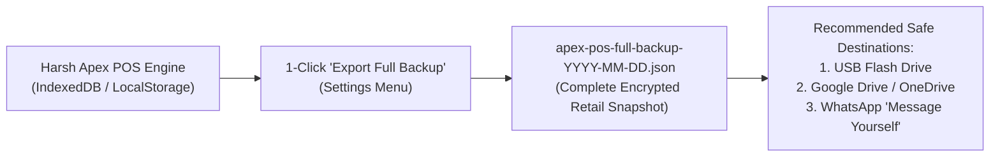
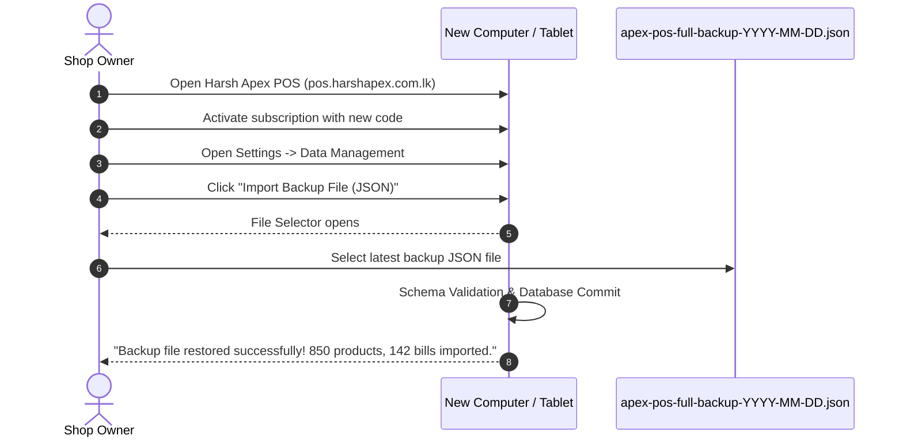
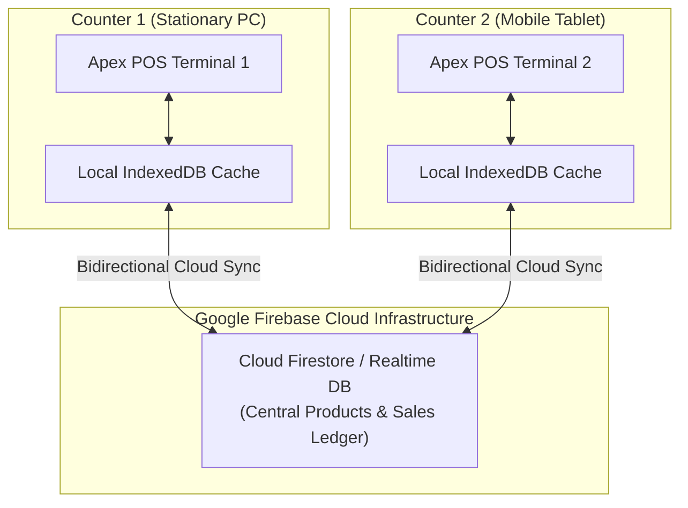

# Harsh Apex POS — Backup & Data Recovery Guide
**Complete Data Safeguarding, Disaster Recovery, and Cloud Sync Manual**

---

## 1. Golden Rules of Retail Data Safeguarding

In a retail store, your database is your most valuable asset. It contains your live product catalog, purchase prices, profit margins, stock counts, customer credit balances (ණය පොත), and daily sales histories.

Harsh Apex POS is architected as an **offline-first system**. This means your POS continues ringing up sales at full speed even during national internet blackouts. However, offline resilience means **you, the shop owner, are the custodian of your local data.**

> [!IMPORTANT]
> **THE 3-2-1 RETAIL BACKUP RULE**
> - **3 Copies:** Keep at least three copies of your data (the active POS terminal, a local daily export, and an offsite copy).
> - **2 Media Types:** Save backups on two different storage locations (e.g. PC Internal Drive + USB Pen Drive or Phone Internal Memory + SD Card).
> - **1 Offsite Copy:** Store one copy outside the physical shop (e.g. Email it to yourself, upload to Google Drive, or send it to your personal WhatsApp chat).

---

## 2. Daily Local Backup (1-Click Full JSON Export)

Harsh Apex POS features an instant, 1-click full database export. It packages your entire retail operation—products, stock levels, sales records, customer ledgers, categories, and store settings—into a compact, portable `.json` file.



### Step-by-Step Daily Backup Procedure (Takes 10 Seconds)
1. At the end of every business day (during register closing / shift handoff):
2. Click or tap the **Settings (Gear Icon)** in the top navigation bar.
3. Scroll down to the **"Data Management & Backups"** section.
4. Click the green button: **"Export Full Backup (JSON)"**.
5. Your browser will instantly generate and download a file named:
   ```text
   apex-pos-full-backup-2026-10-26.json
   ```
6. **Move the file to safety:**
   - On Windows: Copy the file from your `Downloads` folder to a dedicated **USB Pen Drive** or a synchronized cloud folder (Google Drive / OneDrive / Dropbox).
   - On Android / iPhone: Share the downloaded `.json` file to your **WhatsApp "Message Yourself"** or upload it to Google Drive.

---

### What Does the Backup Contain?

```json
{
  "version": 2,
  "exportedAt": "2026-10-26T21:30:00.000Z",
  "shop": {
    "name": "Perera Super Stores",
    "address": "No. 45, Galle Road, Colombo 03",
    "phone": "0770663154",
    "currency": "Rs.",
    "taxRate": 0
  },
  "categories": ["Beverages", "Grocery", "Dairy", "Household", "Snacks"],
  "products": [
    {
      "id": "prod_101",
      "barcode": "4792019001234",
      "name": "Anchor Full Cream Milk Powder 400g",
      "category": "Dairy",
      "buyPrice": 950.00,
      "sellPrice": 1120.00,
      "stock": 48.00,
      "unit": "pcs"
    }
  ],
  "sales": [
    {
      "number": "APX-10042",
      "date": "2026-10-26T14:15:22.000Z",
      "items": [...],
      "subtotal": 2240.00,
      "discount": 0.00,
      "grandTotal": 2240.00,
      "paymentMode": "CASH",
      "cashier": "Kasun"
    }
  ]
}
```

---

## 3. Automated Rolling Snapshots (Local Browser Failsafe)

To protect you against unexpected power surges, sudden Windows restarts, or accidental operator errors, Harsh Apex POS implements an **Automated Rolling Snapshot Engine**.

- Every time a sale is completed, stock is edited, or settings are saved, the system takes an automated internal snapshot.
- The system stores up to **7 rolling historical snapshots** in protected browser sandbox storage.
- Each snapshot is stamped with the exact date, time, bill count, and product count:
  ```text
  Snapshot 0: 2026-10-26 18:45:10 (142 bills, 850 products) [Latest]
  Snapshot 1: 2026-10-26 15:20:04 (118 bills, 850 products)
  Snapshot 2: 2026-10-26 12:00:15 (84 bills, 848 products)
  ...
  Snapshot 6: 2026-10-25 21:00:00 (62 bills, 840 products)
  ```

### How to Restore an Automated Snapshot
If an operator accidentally voided several invoices or edited incorrect product prices:
1. Open POS **Settings**.
2. Locate **"Automated Snapshots"**.
3. Click the dropdown menu and review the available timestamps and item counts.
4. Select the desired snapshot (e.g., the one captured right before the error).
5. Click **"Restore Snapshot"**.
6. Confirm the warning prompt:
   > *"Restore snapshot from [Date Time]? Current unsaved changes will be overwritten."*
7. The database instantly reverts to the selected state, and all products and bills reload immediately.

---

## 4. Restoring Data on a New Device or After Reinstall

When you purchase a new PC or replace a broken smartphone, restoring your entire retail operation takes less than 60 seconds.



### Step-by-Step Restoration Instructions
1. Install and activate Harsh Apex POS on the new device (see [Customer Handover Guide](CUSTOMER_HANDOVER_GUIDE.md)).
2. Connect the USB Pen Drive containing your latest backup, or download your backup `.json` file from Google Drive / WhatsApp.
3. In Harsh Apex POS, navigate to **Settings** -> **Data Management**.
4. Click the blue button: **"Import Backup File (JSON)"**.
5. Select the `apex-pos-full-backup-YYYY-MM-DD.json` file from your device storage.
6. The system will prompt:
   > *"Replace all products and sales with this backup? Be sure to export current data first."*  
   Click **OK**.
7. The system parses the file, validates the database structure, commits all records, and displays:
   > *"Backup file restored successfully!"*
8. Your products, categories, stock balances, and past sales will immediately populate the screen.

---

## 5. CSV Exports: Product Catalogs & Accounting Reports

For spreadsheet analysis in Microsoft Excel or Google Sheets, Harsh Apex POS provides native CSV exports.

### A. Bulk Product Catalog Export & Import (CSV)
- **Exporting Products:** In the **Products** tab, click **"Export CSV"**. A file containing all barcodes, item names, cost prices, retail prices, units, and stock quantities will download.
- **Bulk Price Updates via Excel:**
  1. Export the CSV file and open it in Excel.
  2. Modify selling prices or stock counts in bulk.
  3. Save the file as CSV.
  4. In Harsh Apex POS, click **"Import CSV"** -> Select your modified CSV file.
  5. The POS will update existing items by barcode and add any new items automatically.

### B. Daily & Monthly Sales Reports Export (CSV)
- In the **Reports** tab, filter by your desired date range (e.g. *Today*, *This Week*, *This Month*, or *Custom Range*).
- Click **"Export Report CSV"**.
- Generates an itemized audit sheet with: Bill Number, Timestamp, Payment Method (Cash/Card/Credit), Subtotal, Discount, and Net Grand Total. Perfect for sending to your accountant or auditor.

---

## 6. Disaster Recovery Scenarios & Emergency Playbooks

### Scenario A: "Device storage is full!" Alert
- **Why it happens:** The device's browser cache has reached its allocated quota, or the hard drive is out of free space.
- **Action Plan:**
  1. Immediately click **"Export Full Backup (JSON)"** and save the file safely.
  2. Free up hard drive space on your PC or phone (delete old video clips/downloads).
  3. In Chrome settings -> **Privacy and security** -> **Site settings** -> `pos.harshapex.com.lk` -> clear unused site data if necessary, then immediately re-import your fresh backup.

---

### Scenario B: Accidental "Clear Browsing Data" by Cashier
- **Why it happens:** Someone clicked "Clear History & Cookies" in Google Chrome.
- **Action Plan:**
  1. Do not panic. Locate your most recent daily backup JSON file on your USB drive or Google Drive.
  2. Open Harsh Apex POS in Chrome.
  3. Go to **Settings** -> **Import Backup File (JSON)**.
  4. Select the JSON file and click **OK**.
  5. Your full store is restored in under 10 seconds.

---

### Scenario C: Phone or Computer Hardware Stolen / Destroyed
- **Action Plan:**
  1. Procure a replacement device.
  2. Message Harsh Apex Support on WhatsApp (**+94 77 066 3154**) with your new Device ID to transfer your active subscription slot (see [Customer Handover Guide](CUSTOMER_HANDOVER_GUIDE.md)).
  3. Open Harsh Apex POS, enter your replacement activation code.
  4. Import your latest daily JSON backup. You are 100% back in business!

---

### Scenario D: Transferring Catalog from Counter 1 to Counter 2
When setting up a second checkout counter:
1. On **Counter 1 (Master PC)**: Go to Settings -> Click **"Export Full Backup (JSON)"**.
2. Send the downloaded JSON file to **Counter 2 (Mobile Tablet/Phone)** via WhatsApp or USB.
3. On **Counter 2**: Open POS Settings -> Click **"Import Backup File (JSON)"** -> Select the file.
4. Counter 2 now has the exact same product catalog, barcodes, and pricing as Counter 1!

---

## 7. Cloud Recovery & Multi-Counter Sync with Firebase

For multi-counter retail businesses that require real-time centralized stock deduction and automatic cloud recovery without manual JSON files, Harsh Apex POS features native **Firebase Cloud Integration**.



### How Firebase Cloud Sync Operates
1. **Local-First, Cloud-Synced:** When a bill is finalized on Counter 1, the sale is saved immediately to local storage (0ms latency), and an encrypted JSON document is concurrently pushed to your private Firebase cloud collection.
2. **Centralized Stock Decrement:** When Counter 1 sells an item, Firebase atomically decrements the stock quantity in the cloud. Counter 2 receives a real-time event and updates its local on-screen inventory immediately.
3. **Offline Sync Outbox Queue:** If the internet connection drops on either counter:
   - Cashiers continue billing uninterrupted.
   - Pending sales are queued in an offline IndexedDB outbox.
   - As soon as Wi-Fi or 4G reconnects, the outbox automatically flushes and uploads all queued transactions in chronological order.
4. **Instant Zero-Touch Cloud Recovery:** If a device is permanently lost or replaced, simply logging into your Firebase project from the new device automatically streams down your entire product catalog and transaction history from the cloud—no manual file imports required!

---

## 8. Daily Closing Checklist for Cashiers & Owners

Print this checklist and place it beside the cash register:

```
+-----------------------------------------------------------------------------------+
|                        DAILY SHOP CLOSING CHECKLIST                               |
+-----------------------------------------------------------------------------------+
| [ ] 1. Settle all open carts and finalize all pending bills.                     |
| [ ] 2. Count physical cash in drawer and match against POS Daily Sales Report.    |
| [ ] 3. Settle Credit Card terminal batch on bank EDC machine.                     |
| [ ] 4. Click POS [Settings] -> Click [Export Full Backup (JSON)].                 |
| [ ] 5. Copy the downloaded JSON file to your Shop USB Pen Drive.                 |
| [ ] 6. (Recommended) Send the JSON backup to your personal WhatsApp chat.       |
| [ ] 7. Turn off thermal printer and cash drawer lock.                             |
+-----------------------------------------------------------------------------------+
```
