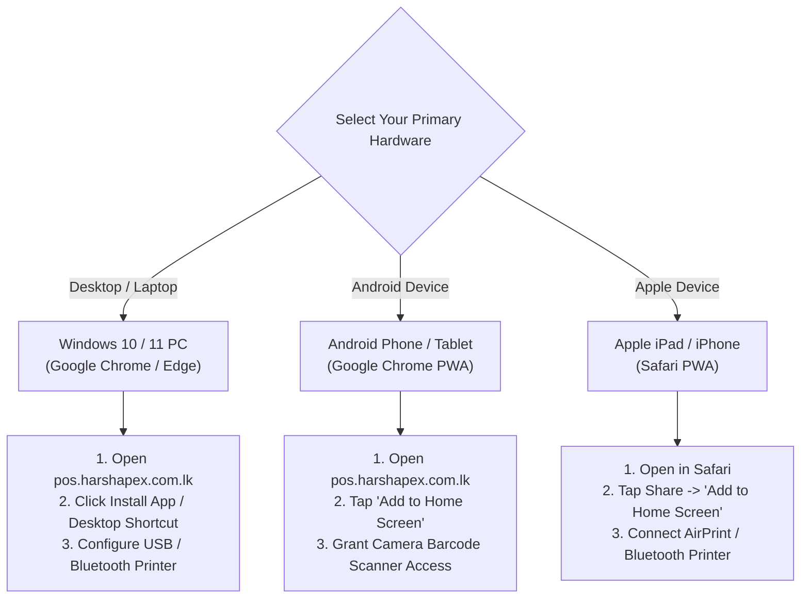
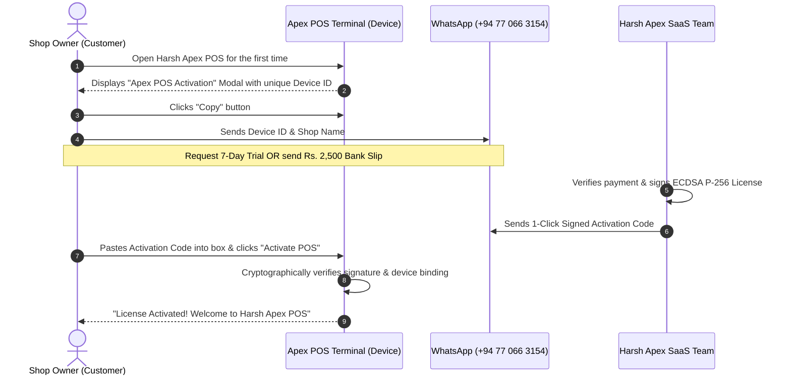

# Harsh Apex POS — Customer Handover & Retail Setup Guide
**Comprehensive Operational Manual for Shop Owners, Cashiers, and Managers in Sri Lanka**

---

## Document Control & System Identification

| Property | Detail |
| :--- | :--- |
| **Product Name** | Harsh Apex Retail Cloud & Offline POS |
| **System Version** | v2.0 Enterprise Multi-Device Edition |
| **Production URL** | [https://pos.harshapex.com.lk](https://pos.harshapex.com.lk) |
| **Local Standalone URL** | `http://localhost:3000/pos.html` |
| **Standard Pricing** | **Rs. 2,500 LKR** per 30-day billing cycle (Covers up to 2 active devices) |
| **Free Evaluation** | **7-Day Free Full-Feature Trial** (No credit card or commitment required) |
| **Customer Care Hotline** | **+94 77 066 3154** (Direct Phone & WhatsApp Support) |
| **Operating Timezone** | Sri Lanka Standard Time (`Asia/Colombo` / UTC +05:30) |

---

## 1. Welcome to Harsh Apex POS

Congratulations on choosing **Harsh Apex POS** for your retail business! Harsh Apex POS is engineered specifically for Sri Lankan supermarkets, grocery stores, pharmacies, textile shops, hardware stores, cafes, and multi-counter retail outlets. 

### Why Harsh Apex POS is Unique
1. **100% Offline Resilience:** If Dialog, Mobitel, SLT, or fiber broadband drops, your billing never stops. Transactions, stock deductions, and receipt printing execute locally in real time.
2. **Dual-Device Flexibility:** Every subscription grants you **two (2) active devices** simultaneously (e.g., Counter 1 Windows Desktop PC + Counter 2 Android Tablet or Mobile Phone).
3. **Hardware Agnostic:** Connect any 58mm or 80mm thermal receipt printer via USB, Bluetooth, Wi-Fi/Ethernet, or Apple AirPrint.
4. **Zero Vendor Lock-in:** You can export your complete inventory and transaction history at any moment with 1-click JSON and CSV exports.

---

## 2. Hardware & Device Setup Instructions

Harsh Apex POS operates as a high-performance **Progressive Web Application (PWA)**. Follow the setup instructions corresponding to your device hardware below.



---

### A. Windows Desktop & Laptop POS Setup

Ideal for stationary billing counters, supermarkets, pharmacies, and wholesale desks.

#### System Requirements
- **Operating System:** Windows 10 or Windows 11 (64-bit recommended).
- **Web Browser:** Google Chrome (Version 110+) or Microsoft Edge.
- **Hardware Peripherals:** USB Thermal Printer (58mm or 80mm), USB Barcode Laser/CCD Scanner, Cash Drawer (RJ11).

#### Step-by-Step Installation
1. Connect your Windows PC to the internet and launch **Google Chrome**.
2. Navigate to: [https://pos.harshapex.com.lk](https://pos.harshapex.com.lk) (or `http://localhost:3000/pos.html` if running from a local server).
3. In Chrome's address bar, look for the **Install App icon** (a monitor icon with a down arrow on the right side of the address bar) and click **"Install Harsh Apex POS"**.
   - *Alternative Method:* Click the Chrome menu (**⋮** three dots) -> **Cast, save, and share** -> **Install page as app...** -> Name it `Harsh Apex POS` and click **Install**.
4. A dedicated desktop shortcut is automatically created on your Windows desktop. Harsh Apex POS will now launch in a clean, distraction-free application window without browser address bars or navigation buttons.
5. **Persistent Storage Activation:** When prompted by the app to allow persistent storage, click **"Allow"**. This guarantees Windows will never automatically purge your offline database during disk cleanup.

#### Silent Kiosk Fast Printing (Under 0.5s Checkout)
To bypass the Windows print dialog completely so receipts shoot out instantly when the cashier presses "Complete Sale":
1. Close all open Google Chrome windows.
2. Right-click the **Harsh Apex POS** shortcut on your Windows desktop -> Select **Properties**.
3. In the **Target** box, add a space at the very end and append `--kiosk-printing`:
   ```text
   "C:\Program Files\Google\Chrome\Application\chrome.exe" --app-id=... --kiosk-printing
   ```
4. Click **Apply** -> **OK**.
5. Inside Harsh Apex POS Settings, enable **"Auto-Print on Bill Finalize: ON"**. Receipts will now print automatically in under half a second without cashier confirmation modals.

---

### B. Android Tablet & Smartphone Setup

Perfect for mobile sales counters, queue-busting during rush hours, field sales, and food trucks.

#### System Requirements
- **OS Version:** Android 9.0 (Pie) or higher.
- **Browser:** Google Chrome for Android (latest version from Google Play Store).
- **Peripherals:** 58mm or 80mm Bluetooth thermal printer (BLE or Classic SPP).

#### Step-by-Step Installation
1. Open **Google Chrome** on your Android tablet or smartphone.
2. Visit: [https://pos.harshapex.com.lk](https://pos.harshapex.com.lk).
3. Chrome will display an installation banner at the bottom of the screen: **"Add Harsh Apex POS to Home screen"**. Tap **Install**.
   - *If the banner does not appear:* Tap the Chrome menu (**⋮** three dots in the top right corner) -> Tap **"Add to Home screen"** or **"Install app"**.
4. Tap **Install** on the confirmation prompt. The Harsh Apex POS icon will appear on your device's home screen alongside your regular native apps.
5. **Camera Barcode Scanner Permissions:** Launch the newly installed app from your home screen. When opening the barcode scanner for the first time, Android will ask:
   > *"Allow Harsh Apex POS to take pictures and record video?"*  
   Select **"While using the app"**. This enables high-speed instant barcode scanning using your phone's rear camera.
6. **Battery Optimization Exclusion:** Go to Android **Settings** -> **Apps** -> **Harsh Apex POS** -> **Battery** -> Select **"Unrestricted"**. This prevents Android from putting the POS app to sleep during prolonged idle periods at the counter.

---

### C. Apple iPad & iPhone Setup

Preferred by boutique fashion stores, bakeries, cafes, and modern retail showrooms.

#### System Requirements
- **OS Version:** iOS 15.0 or iPadOS 15.0 or higher.
- **Web Browser:** Apple **Safari** (PWA installation must be performed through Safari).
- **Peripherals:** Apple AirPrint-certified thermal receipt printer or companion Bluetooth printer.

#### Step-by-Step Installation
1. Open **Safari** on your iPad or iPhone.
2. Browse to: [https://pos.harshapex.com.lk](https://pos.harshapex.com.lk).
3. Tap the **Share Button** (the square icon with an upward-pointing arrow located in the Safari toolbar).
4. Scroll down the share sheet and tap **"Add to Home Screen"** (ගෘහස්ථ තිරයට එක් කරන්න).
5. The name will default to **"Harsh Apex POS"**. Tap **Add** in the top-right corner.
6. Close Safari. Tap the **Harsh Apex POS** app icon on your iOS home screen. The POS will launch in full-screen standalone mode with no Safari navigation bars.
7. When opening the camera barcode scanner, tap **"Allow"** when prompted for camera access.

---

## 3. Subscription & Activation Walkthrough

Harsh Apex POS uses secure, cryptographically signed cryptographic licenses (ECDSA P-256). You can activate the system in less than two minutes.



### Understanding Your Device ID
When you first open Harsh Apex POS on any computer or phone, the software inspects the device hardware and browser sandbox to generate a unique Sri Lankan hardware serial identifier:
```text
APX-LK-XXXXXXXXXXXX  (e.g., APX-LK-7B29F01A4E88)
```
> [!IMPORTANT]
> **Every physical device generates its own distinct Device ID.** An activation code generated for your PC will not work on your phone, and vice-versa. Each code is mathematically locked to that specific device.

---

### Plan Options & Pricing

| Plan Type | Fee | Duration | Devices Included | How to Request |
| :--- | :---: | :---: | :---: | :--- |
| **Free Evaluation Trial** | **Rs. 0 (Free)** | **7 Days** (604,800,000 ms) | Up to 2 Devices | Tap **"Send Details on WhatsApp"** directly from the activation screen. |
| **Standard Monthly** | **Rs. 2,500 LKR** | **30 Days** (2,592,000,000 ms) | Up to 2 Devices | Transfer Rs. 2,500 to our bank account and send the payment slip on WhatsApp. |
| **Annual Package** | Inquire for Offer | 365 Days | Up to 2 Devices | Contact customer support at +94 77 066 3154. |

#### Bank Payment Details for Sri Lanka
- **Bank Name:** Commercial Bank of Ceylon / Sampath Bank / Bank of Ceylon (BOC)
- **Account Name:** Harsh Apex Solutions (Pvt) Ltd
- **Account Number:** *(Provided via official WhatsApp chat +94 77 066 3154)*
- **Supported Payment Gateways:** Online Banking Transfer, CDM Cash Deposit, FriMi, Genie, eZ Cash.

---

### Step-by-Step Activation Instructions

1. **Obtain Your Device ID:**
   - Launch Harsh Apex POS. If your terminal is unactivated or expired, the **Apex POS Activation** gate appears automatically.
   - Click the green **"Copy"** button next to your Device ID.
2. **Contact Support on WhatsApp:**
   - Click the green button: **"Send Details on WhatsApp"**.
   - Your WhatsApp will open with a pre-filled message addressed to **+94 77 066 3154**:
     ```text
     Hello Harsh Apex, I need an Apex POS activation. Device ID: APX-LK-XXXXXXXXXXXX
     ```
   - State your **Shop Name**, **Owner Name**, and whether you are requesting the **7-Day Free Trial** or renewing your **Rs. 2,500 Monthly Subscription** (attach your bank slip).
3. **Receive and Enter Your Activation Code:**
   - Our team will immediately reply with your cryptographic activation code (a Base64URL string).
   - Copy the entire code.
   - Return to Harsh Apex POS, paste the code into the **"Activation Code"** text area, and click **"Activate POS"**.
4. **Instant Unlock:**
   - The activation gate disappears, and your POS terminal opens immediately.
   - At the top of your screen, the **Sliding Expiry Clock** displays your active plan and remaining subscription days/hours in real time.

---

## 4. Two-Device Linking Flow (Multi-Counter Operation)

Every active subscription includes support for **two (2) active devices** at no extra charge! This allows you to run two simultaneous checkout points or pair a front cashier PC with a mobile manager tablet.

```
+-----------------------------------------------------------------------------------+
|                        HARSH APEX SUBSCRIPTION (Rs. 2,500 / Month)                |
|                                                                                   |
|         +---------------------------+       +---------------------------+         |
|         |     ACTIVE SLOT 1 / 2     |       |     ACTIVE SLOT 2 / 2     |         |
|         |  Main Counter 1 (PC)      |       |  Mobile Counter 2 (Phone) |         |
|         |  ID: APX-LK-AAAA1111      |       |  ID: APX-LK-BBBB2222      |         |
|         +---------------------------+       +---------------------------+         |
|                       |                                   |                       |
|                       +-----------------+-----------------+                       |
|                                         |                                         |
|                                         v                                         |
|                       SHARED EXPIRATION TIMESTAMP                                 |
|                       Both devices expire on the EXACT same day!                  |
+-----------------------------------------------------------------------------------+
```

### How to Link Your Second Device
1. Install Harsh Apex POS on your **second device** (e.g., your Android phone or second PC).
2. Open the app to view the activation screen. Click **"Copy"** next to the second Device ID.
3. Message our WhatsApp support hotline (**+94 77 066 3154**):
   > *"Please link my 2nd device to my active subscription. Shop Name: [Your Shop Name], 2nd Device ID: APX-LK-BBBB2222"*.
4. Our administrator links the device in the SaaS Command Center and provides a dedicated activation code for Device 2.
5. Paste the code on Device 2 and tap **"Activate POS"**. Both devices are now fully operational!

---

### Critical Policies: Shared Expiry & Data Independence

> [!WARNING]
> **NO SUBSCRIPTION EXTENSION ON LINKING**  
> Linking a second device **never** extends or restarts your subscription period. Both devices share the exact same expiry timestamp. For example: if Device 1 has 19 days remaining when Device 2 is linked, **both devices will expire in exactly 19 days**.

> [!CAUTION]
> **INDEPENDENT OFFLINE DATA STORAGE NOTICE**  
> Harsh Apex POS is an offline-first system. By default, **sales records, product stock counts, customer credit ledgers, and transaction histories are stored locally inside the browser on each physical device.**  
> - Sales made on Counter 1 do not automatically show up on Counter 2 while operating offline.  
> - To share or mirror product inventory, simply export a JSON backup from Counter 1 and import it into Counter 2 (see [Backup Guide](BACKUP_AND_DATA_RECOVERY_GUIDE.md)), or enable Firebase Cloud Sync.

#### Official Sinhala Customer Notice:
> ***"Devices දෙකටම එකම subscription කාලය අදාළ වේ. Products, stock සහ sales දත්ත ස්වයංක්‍රීයව devices අතර sync නොවේ."***

---

## 5. Replacing a Lost, Damaged, or Upgraded Device

Smartphones drop, screens break, and retail PCs get replaced. With Harsh Apex POS, **you will NEVER lose your remaining subscription days** when changing hardware.

```
Scenario: Phone screen breaks when you have 18 days left on your subscription.
1. Old broken phone (Slot 2) is decommissioned.
2. New replacement phone is registered with our admin.
3. Your new phone receives an activation code with all 18 remaining days intact!
4. Counter 1 (Slot 1) continues billing without a single second of interruption.
```

### Step-by-Step Device Replacement Procedure
1. Install Harsh Apex POS on your new computer or phone.
2. Note the new **Device ID** from the activation screen.
3. Contact WhatsApp support (**+94 77 066 3154**) and explain:
   > *"My cashier phone screen broke. I need to replace it under my active subscription. Shop Name: [Your Shop], Old Device: Phone 2, New Device ID: APX-LK-CCCC3333"*.
4. Our administrator marks the old broken device binding as `replaced` in the database and generates a replacement token bound to the new Device ID.
5. The replacement code is sent to you immediately.
6. Paste the code into your new device to resume billing.

> [!IMPORTANT]
> **DATA TRANSFER ON REPLACEMENT**  
> Transferring a license code unlocks the software on the new phone, but it **cannot magically recover offline sales data trapped inside a destroyed device**. Always take daily JSON backups so you can restore your stock and sales onto your new device in seconds!
>
> ***Sinhala Notice:***  
> *"Activation transfer කිරීමෙන් පැරණි phone එකේ sales/stock data නැවත ලබාගත නොහැක. ඒ සඳහා backup එකක් අවශ්‍ය වේ."*

---

## 6. Cashier Quick Reference: Daily Billing Guide

```
+---------------------------------------------------------------------------------+
|                              DAILY CASHIER CHEAT SHEET                          |
+---------------------------------------------------------------------------------+
| 1. ADD ITEM TO CART  -> Scan Barcode OR Type Name in Search OR Tap Category Tab |
| 2. ADJUST QUANTITY   -> Click [+] or [-] on cart line, or type exact quantity   |
| 3. APPLY DISCOUNT    -> Click Discount button -> Enter % or Flat Rs. amount     |
| 4. SELECT PAYMENT    -> Click [CASH], [CARD], or [CREDIT / ණය]                  |
| 5. ENTER AMOUNT PAID -> Type customer cash given (POS calculates change return) |
| 6. FINALIZE SALE     -> Click [COMPLETE SALE / F2] -> Receipt Prints Instantly  |
| 7. VOID / CANCEL     -> Go to Reports -> Select Bill -> Click [Void Bill]       |
+---------------------------------------------------------------------------------+
```

### Step 1: Adding Products to a Sale
- **Laser / CCD Barcode Scanner:** Simply point the scanner at the item's barcode. The item is automatically looked up and added to the cart with audible feedback.
- **On-Screen Search Bar:** Type any part of the product name, brand, or SKU into the search box. Results filter instantly as you type.
- **Touch Category Grid:** Tap categories (e.g. *Beverages*, *Grocery*, *Stationery*, *Bakery*) to view large, color-coded touch buttons for fast counter selection.

### Step 2: Payment Methods
Harsh Apex POS natively supports Sri Lankan retail payment workflows:
- **Cash (මුදල්):** Enter the amount tendered by the customer. The system calculates and displays the exact change due (ඉතිරි මුදල) in large high-contrast numbers.
- **Card (කාඩ්පත්):** For Visa, Mastercard, and LankaPay POS card terminal transactions. Prompts for optional last-4 card digits and terminal approval code.
- **Credit (ණය ගනුදෙනු):** Assign the invoice to a registered customer account. The invoice amount is posted directly to their credit ledger with tracking for repayments.

### Step 3: Voiding Bills & Stock Auto-Restoration
If a customer changes their mind or a bill was rung up erroneously:
1. Tap the **Reports (වාර්තා)** tab in the main navigation.
2. Select the bill from the list to view its itemized breakdown.
3. Click the red **"Void / Cancel Bill"** button.
4. Confirm the prompt. The system marks the bill as canceled, reverses the transaction total, and **automatically restores every item's quantity back into your live inventory stock**.

---

## 7. Customer Support & Service Level Agreement (SLA)

| Channel | Contact Info | Availability |
| :--- | :--- | :--- |
| **Official WhatsApp Support** | **+94 77 066 3154** | 7:00 AM – 10:00 PM (Daily, including Poya & Holidays) |
| **Direct Voice Call** | **+94 77 066 3154** | Urgent billing counter emergencies |
| **Email Support** | `support@harshapex.com.lk` | Account inquiries, custom software feature requests |
| **Official Web Portal** | [https://harshapex.com.lk](https://harshapex.com.lk) | Documentation updates & announcements |

### What to Prepare When Contacting Support
To resolve your request in under 5 minutes, please have the following ready:
1. Your **Shop Name** and registered **Owner Name**.
2. Your current **Device ID** (found on the activation screen or in the POS Settings menu).
3. A photo or screenshot of any error message displayed on your screen.
