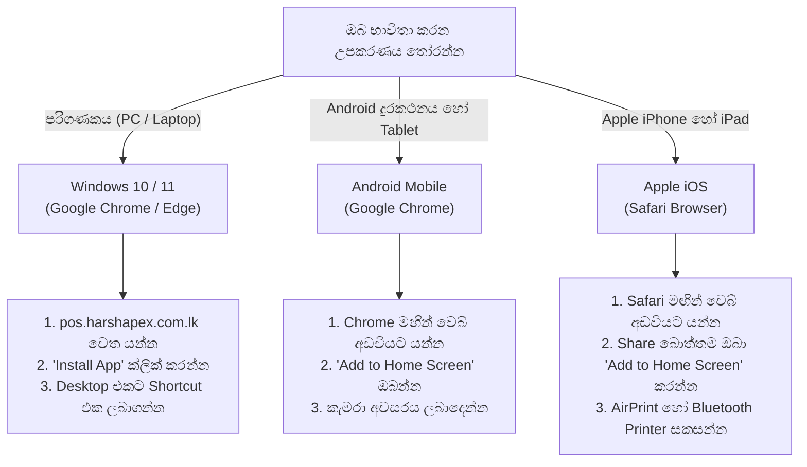
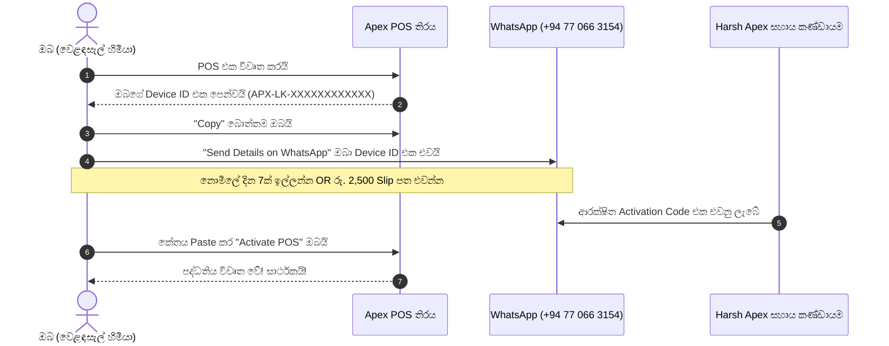
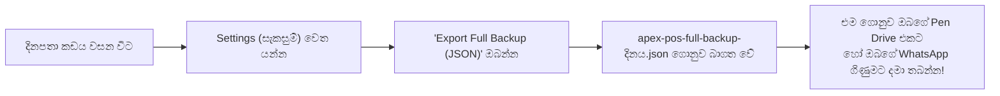

# Harsh Apex POS — පාරිභෝගික අත්පොත සහ මෙහෙයුම් මාර්ගෝපදේශය
**ශ්‍රී ලංකාවේ වෙළඳසැල් හිමියන් සහ මුදල් අයකැමියන් (Cashiers) සඳහා වන සම්පූර්ණ උපදෙස් සංග්‍රහය**

---

## 1. Harsh Apex POS වෙත ඔබව සාදරයෙන් පිළිගනිමු!

ඔබගේ ව්‍යාපාරයේ විකුණුම් සහ තොග පාලනය වඩාත් පහසු සහ වේගවත් කරගැනීම සඳහා **Harsh Apex POS** තෝරාගැනීම පිළිබඳව අපගේ ස්තූතිය!

Harsh Apex POS යනු ශ්‍රී ලංකාවේ සුපිරි වෙළඳසැල්, සිල්ලර කඩ, ඖෂධසැල්, රෙදිපිළි වෙළඳසැල්, හෝටල් සහ තොග වෙළඳ ව්‍යාපාර සඳහාම විශේෂයෙන් නිපදවන ලද නවීනතම මෘදුකාංග පද්ධතියකි.

### ප්‍රධාන වාසි:
1. **100% Offline ක්‍රියාකාරිත්වය:** අන්තර්ජාලය (Internet / Wi-Fi / Data) විසන්ධි වුවද බිල්පත් කිරීම, මුද්‍රණය කිරීම සහ තොග අඩු වීම කිසිදු බාධාවකින් තොරව සිදුවේ.
2. **උපකරණ 2ක් එකවර භාවිතය:** එක් Subscription එකක් මඟින් උපකරණ 2ක් (උදා: ප්‍රධාන කවුන්ටර පරිගණකය + ජංගම දුරකථනය) එකවර භාවිතා කළ හැක.
3. **ඕනෑම Printer එකක් සම්බන්ධ කළ හැක:** 58mm සහ 80mm Thermal Receipt Printers (USB, Bluetooth, Wi-Fi, AirPrint) පහසුවෙන්ම සම්බන්ධ කළ හැක.
4. **දත්තවල පූර්ණ අයිතිය ඔබ සතුය:** ඔබගේ සියලුම බිල්පත් සහ භාණ්ඩ විස්තර ඕනෑම මොහොතක Excel (CSV) හෝ JSON ගොනුවක් ලෙස නොමිලේ බාගත කරගත හැක.

---

## 2. මූලික තොරතුරු සහ ගාස්තු විස්තර

| විස්තරය | තොරතුරු |
| :--- | :--- |
| **මෘදුකාංගයේ නම** | Harsh Apex Retail Cloud & Offline POS (v2.0) |
| **භාවිතා කරන වෙබ් ලිපිනය** | [https://pos.harshapex.com.lk](https://pos.harshapex.com.lk) |
| **නොමිලේ අත්හදා බැලීම** | **දින 7ක් නොමිලේ (7-Day Free Trial)** — සියලුම පහසුකම් සහිතයි |
| **මාසික ගාස්තුව** | **රුපියල් 2,500 LKR (දින 30ක් සඳහා)** — උපකරණ 2ක් ඇතුළත් වේ |
| **පාරිභෝගික සේවා WhatsApp අංකය** | **+94 77 066 3154** (දුරකථන සහ WhatsApp සහාය) |

---

## 3. උපකරණ සකසා ගැනීම (Hardware Setup Guide)

Harsh Apex POS මෘදුකාංගය ඔබගේ Windows පරිගණකය, Android දුරකථනය/ටැබ්ලටය, හෝ Apple iPad/iPhone යන ඕනෑම උපකරණයක App එකක් ලෙස පහසුවෙන්ම ස්ථාපනය කරගත හැක.



---

### A. Windows පරිගණක සහ ලැප්ටොප් සඳහා (Desktop PC)

1. පරිගණකයේ **Google Chrome** බ්‍රවුසරය විවෘත කරන්න.
2. [https://pos.harshapex.com.lk](https://pos.harshapex.com.lk) වෙබ් ලිපිනයට පිවිසෙන්න.
3. Chrome හි ඉහළ ලිපින තීරුවේ (Address Bar) දකුණු පස ඇති **Install App** අයිකනය (පරිගණක තිරයක හැඩය ඇති කුඩා ලකුණ) ක්ලික් කර **"Install Harsh Apex POS"** තෝරන්න.
   *(හෝ Chrome හි ඉහළ දකුණු කෙළවරේ තිත් තුන [⋮] ක්ලික් කර -> Cast, save, and share -> Install page as app තෝරන්න).*
4. දැන් ඔබගේ පරිගණක තිරයේ (Desktop) **Harsh Apex POS** නමින් වෙනම Shortcut එකක් නිර්මාණය වේ.
5. එය මත Double-click කළ විට බ්‍රවුසර් බොත්තම් රහිතව සම්පූර්ණ මුහුණතකින් මෘදුකාංගය විවෘත වේ.

#### තත්පරයෙන් බිල මුද්‍රණය වන Kiosk Printing සැකසුම (අත්‍යවශ්‍යයි):
මුදල් අයකැමියා "Complete Sale" එබූ සැනින් කිසිදු preview එකකින් තොරව කෙලින්ම රිසිට්පත මුද්‍රණය වීමට:
1. විවෘතව ඇති සියලුම Chrome windows වසන්න.
2. Desktop එකේ ඇති **Harsh Apex POS** shortcut එක මත Right-click කර **Properties** වෙත යන්න.
3. **Target** කොටුවේ කෙළවරට හිස්තැනක් තබා `--kiosk-printing` එකතු කරන්න:
   ```text
   "C:\Program Files\Google\Chrome\Application\chrome.exe" --app-id=... --kiosk-printing
   ```
4. **Apply** කර **OK** ඔබන්න.

---

### B. Android ස්මාර්ට්ෆෝන් සහ ටැබ්ලට් සඳහා (Android Phone / Tablet)

1. ඔබගේ Android දුරකථනයේ **Google Chrome** විවෘත කරන්න.
2. [https://pos.harshapex.com.lk](https://pos.harshapex.com.lk) වෙත පිවිසෙන්න.
3. තිරයේ පහළින් **"Add Harsh Apex POS to Home screen"** හෝ **"Install App"** යනුවෙන් පණිවිඩයක් දිස්වේ. එහි **Install** ඔබන්න.
   *(එසේ නොපෙනේ නම්, Chrome හි ඉහළ දකුණු කෙළවරේ තිත් තුන [⋮] ඔබා **"Add to Home screen"** තෝරන්න).*
4. ස්වල්ප වේලාවකින් ඔබගේ දුරකථනයේ අනෙකුත් Apps සමඟ Harsh Apex POS අයිකනය දැකගත හැක.
5. **Barcode Scanner කැමරා අවසරය:** App එක විවෘත කර කැමරාවෙන් Barcode ස්කෑන් කිරීමට උත්සාහ කරන විට අසන ප්‍රශ්නයට **"While using the app"** (App එක භාවිතා කරන අතරතුර) තෝරන්න.
6. **Battery Optimization ඉවත් කිරීම:** දුරකථනයේ Settings -> Apps -> Harsh Apex POS -> Battery වෙත ගොස් **"Unrestricted"** තෝරන්න. ಇದರಿಂದ තිරය ක්‍රියා විරහිත වුවද දත්ත සුරක්ෂිතව පවතී.

---

### C. Apple iPhone සහ iPad සඳහා (Apple iOS)

1. ඔබගේ Apple උපකරණයේ **Safari** බ්‍රවුසරය විවෘත කරන්න.
2. [https://pos.harshapex.com.lk](https://pos.harshapex.com.lk) වෙත පිවිසෙන්න.
3. Safari හි පහළ ඇති **Share බොත්තම** (ඉහළට ඊතලයක් සහිත කොටු ලකුණ) ඔබන්න.
4. පහළට scroll කර **"Add to Home Screen"** (ගෘහස්ථ තිරයට එක් කරන්න) තෝරන්න.
5. ඉහළ දකුණු කෙළවරේ ඇති **Add** ඔබන්න.
6. දැන් Home screen එක මත දිස්වන Harsh Apex POS අයිකනය මතින් App එකක් ලෙස විවෘත කළ හැක.

---

## 4. Activation ක්‍රියාවලිය (පියවරෙන් පියවර)

මෘදුකාංගය ප්‍රථම වරට විවෘත කළ විට **Apex POS Activation** තිරය දිස්වේ.



### පියවර 1: ඔබගේ Device ID එක ලබාගැනීම
- තිරයේ මැද ඔබගේ උපකරණයට අනන්‍ය වූ **Device ID** අංකයක් දිස්වේ (උදාහරණයක් ලෙස: `APX-LK-7B29F01A4E88`).
- ඒ අසල ඇති කොළ පැහැති **"Copy"** බොත්තම ඔබන්න.

### පියවර 2: WhatsApp හරහා අප වෙත යොමු කිරීම
- තිරයේ ඇති කොළ පැහැති **"Send Details on WhatsApp"** බොත්තම ඔබන්න.
- එවිට ස්වයංක්‍රීයව ඔබගේ WhatsApp විවෘත වී අපගේ පාරිභෝගික සේවා අංකයට (**+94 77 066 3154**) පණිවිඩයක් සකස් වේ.
- එහි ඔබගේ **කඩේ නම**, **ඔබගේ නම** ඇතුළත් කර එවන්න:
  * **නොමිලේ අත්හදා බැලීමට නම්:** "Free Trial එකක් ලබාදෙන්න" ලෙස දන්වන්න.
  * **මාසික Subscription සඳහා නම්:** රු. 2,500 මුදල අපගේ බැංකු ගිණුමට තැන්පත් කර එම රිසිට්පත (Bank Slip / Online Transfer Screenshot) අමුණා එවන්න.

### පියවර 3: Activation Code එක ඇතුළත් කිරීම
- අප විසින් මිනිත්තු කිහිපයක් ඇතුළත ඔබට දීර්ඝ අකුරු සහ ඉලක්කම් සහිත ආරක්ෂිත **Activation Code** එකක් එවනු ලැබේ.
- එම කේතය සම්පූර්ණයෙන්ම Copy කරගන්න.
- නැවත POS තිරය වෙත පැමිණ, **"Activation Code"** කොටුව තුළ Paste කරන්න.
- **"Activate POS"** බොත්තම ඔබන්න.
- පද්ධතිය ක්ෂණිකව විවෘත වන අතර ඉහළ තීරුවේ ඔබගේ Subscription එක සහ ඉතිරි කාලය පෙන්වන **Sliding Clock** එක දිස්වේ.

---

## 5. එකම Subscription එකෙන් උපකරණ 2ක් භාවිතා කිරීම

ඔබ ලබාගන්නා සෑම Subscription එකකටම **අමතර කිසිදු ගාස්තුවකින් තොරව උපකරණ 2ක්** සම්බන්ධ කළ හැක (උදා: කවුන්ටරය 1 සඳහා පරිගණකය සහ කවුන්ටරය 2 සඳහා දුරකථනය).

### දෙවන උපකරණය සම්බන්ධ කරගන්නේ කෙසේද?
1. ඔබගේ දෙවන දුරකථනයේ හෝ පරිගණකයේ Harsh Apex POS විවෘත කරන්න.
2. එහි ඇති **දෙවන Device ID** එක Copy කරගන්න.
3. අපගේ WhatsApp අංකයට (+94 77 066 3154) පණිවිඩයක් එවන්න:
   > *"කරුණාකර මගේ 2 වන Device එක සම්බන්ධ කරන්න. කඩේ නම: [ඔබගේ කඩේ නම], Device 2 ID: APX-LK-XXXXXXXXXXXX"*
4. අපගේ පද්ධතිය මඟින් දෙවන උපකරණය සඳහා නව කේතයක් නිකුත් කරනු ලැබේ.
5. එය දෙවන උපකරණයට ඇතුළත් කළ පසු උපකරණ දෙකෙන්ම එකවර බිල්පත් කළ හැක!

---

### අතිශය වැදගත් නීති 2ක් (Important Notices)

> [!WARNING]
> **1. උපකරණ දෙකටම එකම වලංගු කාලය (Shared Expiry):**  
> දෙවන උපකරණය සම්බන්ධ කළද මුල් දින ගණන අලුත් නොවේ. උපකරණ දෙකම එකම දිනයකදී අවසන් වේ. (උදාහරණයක් ලෙස: පළමු පරිගණකයේ තව දින 18ක් ඉතිරිව තිබියදී දෙවන දුරකථනය සම්බන්ධ කළහොත්, දුරකථනයටද ලැබෙන්නේ එම දින 18ක කාලය පමණි).

> [!CAUTION]
> **2. දත්ත වෙන්ව පැවතීම පිළිබඳ දැනුම්දීම (Data Independence):**  
> Harsh Apex POS අන්තර්ජාලය නොමැතිව (Offline) ක්‍රියාත්මක වන බැවින්, **එක් උපකරණයක සිදුකරන විකුණුම් සහ භාණ්ඩ තොග විස්තර අනෙක් උපකරණයට ස්වයංක්‍රීයව හුවමාරු නොවේ.**  
> - පළමු පරිගණකයේ බිල්පත් පළමු පරිගණකයේ පමණක් සටහන් වේ.  
> - පළමු පරිගණකයේ ඇති භාණ්ඩ ලැයිස්තුව දෙවන දුරකථනයට ලබාගැනීමට 1-Click Backup එකක් ලබාගෙන දෙවන දුරකථනයට ඇතුළත් (Import) කරන්න (පහත 8 වන කොටස බලන්න).
>
> ***නිල නිවේදනය:***  
> *"Devices දෙකටම එකම subscription කාලය අදාළ වේ. Products, stock සහ sales දත්ත ස්වයංක්‍රීයව devices අතර sync නොවේ."*

---

## 6. දුරකථනය නැතිවූ විට හෝ කැඩුන විට මාරු කිරීම (Device Replacement)

දුරකථනයක් කැඩී බිඳී යාම හෝ නැතිවීම සාමාන්‍ය සිදුවීමකි. එවැනි අවස්ථාවක **ඔබගේ ඉතිරි දින ගණන කිසිසේත්ම අපතේ නොයයි!**

```
උදාහරණය:
ඔබගේ බිල් දමන දුරකථනය කැඩී යන විට දින 15ක් ඉතිරිව තිබුණි.
1. ඔබ අලුත් දුරකථනයක් ලබාගනී.
2. අපගේ WhatsApp අංකයට දන්වයි.
3. අලුත් දුරකථනයට එම ඉතිරි දින 15ම සම්පූර්ණයෙන්ම ලබාදෙනු ලැබේ!
4. කවුන්ටරයේ අනෙක් පරිගණකය කිසිදු බාධාවකින් තොරව ක්‍රියාත්මක වේ.
```

### පියවර:
1. නව දුරකථනයට Harsh Apex POS ස්ථාපනය කරන්න.
2. එහි දිස්වන නව **Device ID** එක සටහන් කරගන්න.
3. අපගේ WhatsApp අංකයට (+94 77 066 3154) දන්වන්න:
   > *"මගේ පැරණි දුරකථනය කැඩුනා. මට අලුත් දුරකථනයට License එක මාරු කර දෙන්න. කඩේ නම: [ඔබගේ කඩේ නම], අලුත් Device ID: APX-LK-YYYYYYYYYYYY"*
4. අප විසින් පැරණි දුරකථනය අක්‍රිය කර නව දුරකථනය සඳහා නව කේතයක් නිකුත් කරනු ලැබේ.

> [!IMPORTANT]
> **පැරණි දත්ත පිළිබඳ දැඩි අවවාදයයි:**  
> Activation code එක මාරු කිරීමෙන් මෘදුකාංගය විවෘත වුවද, **කැඩී ගිය දුරකථනයේ තිබූ බිල්පත් සහ තොග දත්ත ස්වයංක්‍රීයව අලුත් දුරකථනයට නොපැමිණේ.** ඒ සඳහා ඔබ දිනපතා ලබාගන්නා Backup ගොනුව භාවිතා කළ යුතුය!
>
> ***නිල නිවේදනය:***  
> *"Activation transfer කිරීමෙන් පැරණි phone එකේ sales/stock data නැවත ලබාගත නොහැක. ඒ සඳහා backup එකක් අවශ්‍ය වේ."*

---

## 7. දෛනික බිල්පත් කිරීම (Cashier Quick Guide)

```
+---------------------------------------------------------------------------------+
|                       අයකැමි සඳහා කෙටි උපදෙස් පත්‍රිකාව                         |
+---------------------------------------------------------------------------------+
| 1. භාණ්ඩය එකතු කිරීම  -> Barcode එක ස්කෑන් කරන්න OR නම ටයිප් කරන්න           |
| 2. ප්‍රමාණය වෙනස් කිරීම -> කරත්තයේ ඇති [+] හෝ [-] ඔබන්න                       |
| 3. වට්ටම් (Discount)   -> Discount බොත්තම ඔබා ප්‍රතිශතය (%) හෝ මුදල ඇතුළත් කරන්න |
| 4. ගෙවීම් ක්‍රමය       -> [මුදල් (CASH)], [කාඩ්පත් (CARD)], හෝ [ණය (CREDIT)]   |
| 5. ලැබුණු මුදල        -> පාරිභෝගිකයා දුන් මුදල ටයිප් කරන්න (ඉතිරිය පෙන්වයි)    |
| 6. බිල අවසන් කිරීම    -> [COMPLETE SALE] ඔබන්න -> රිසිට්පත මුද්‍රණය වේ       |
| 7. බිලක් අවලංගු කිරීම -> Reports වෙත ගොස් බිල තෝරා [Void Bill] ඔබන්න           |
+---------------------------------------------------------------------------------+
```

### ගෙවීම් ක්‍රම 3:
- **මුදල් (Cash):** පාරිභෝගිකයා දුන් මුදල ඇතුළත් කළ විට පාරිභෝගිකයාට දිය යුතු ඉතිරි මුදල (Change) තිරයේ විශාල අකුරින් දිස්වේ.
- **කාඩ්පත් (Card):** Credit / Debit Card මඟින් ගෙවූ විට තෝරන්න.
- **ණය (Credit):** පාරිභෝගිකයාගේ නම තෝරා බිල ණය පොතට ඇතුළත් කළ හැක.

### බිලක් අවලංගු කිරීම (Void Bill):
යම් බිලක් වැරදීමකින් දැමුවහොත් හෝ පාරිභෝගිකයා භාණ්ඩ ආපසු දුනහොත්:
1. **Reports (වාර්තා)** ටැබ් එකට යන්න.
2. අදාළ බිල තෝරන්න.
3. රතු පැහැති **"Void Bill"** බොත්තම ඔබන්න.
4. බිල අවලංගු වන අතර, **එහි තිබූ සියලුම භාණ්ඩ ප්‍රමාණ ස්වයංක්‍රීයව නැවත Stock එකට එකතු වේ!**

---

## 8. රිසිට්පත් මුද්‍රණය (Receipt Printing)

Harsh Apex POS සමඟ ලංකාවේ බහුලව ඇති **58mm කුඩා Bluetooth Printers** (GOOJPRT PT-210, MPT-III) සහ **80mm ලොකු USB / LAN Printers** (Xprinter, Epson) පහසුවෙන්ම භාවිතා කළ හැක.

### Bluetooth Printer සම්බන්ධ කිරීම (Android / Windows):
1. Printer එක On කර එහි Bluetooth නිල් පැහැති ආලෝකය දැල්වෙන බව තහවුරු කරගන්න.
2. POS එකේ **Settings (Gear Icon)** -> **Printer Settings** වෙත යන්න.
3. Print Transport ලෙස **"Web Bluetooth (BLE GATT)"** තෝරන්න.
4. **"Pair Bluetooth Printer"** ඔබා ඔබගේ Printer එක තෝරා Pair කරන්න.
5. PIN අංකයක් ඇසුවහොත් `0000` හෝ `1234` ඇතුළත් කරන්න.
6. **"Test Print"** ඔබා බලන්න.

### සුලභ ගැටළු සහ විසඳුම්:
- **කඩදාසිය එළියට එන නමුත් කිසිවක් මුද්‍රණය නොවේ නම්:**  
  *විසඳුම:* Thermal කඩදාසි රෝලය උඩු යටිකුරු වී ඇත. රෝලය ගලවා අනෙක් පැත්ත හරවා දමන්න. (නියපිටින් කඩදාසිය සීරූ විට කළු ඉරක් ඇඳෙන පැත්ත මුද්‍රණ හිස දෙසට තිබිය යුතුය).
- **දකුණු පැත්තේ අකුරු කැපී යන්නේ නම්:**  
  *විසඳුම:* Settings වෙත ගොස් ඔබගේ කඩදාසි ප්‍රමාණය `58mm (32 Columns)` හෝ `80mm (48 Columns)` නිවැරදිව තෝරන්න. Chrome print settings වල Margins "None" කරන්න.
- **සිංහල අකුරු ප්‍රශ්න ලකුණු `????` ලෙස මුද්‍රණය වන්නේ නම්:**  
  *විසඳුම:* Settings හි **"High-Quality Sinhala Canvas Mode"** සක්‍රිය කරන්න. එවිට සිංහල අකුරු අතිශය පැහැදිලිව මුද්‍රණය වේ.

---

## 9. දත්ත සුරැකීම සහ Backups (Data Protection)

ඔබගේ ව්‍යාපාරයේ සියලුම ගිණුම්, බිල්පත් සහ භාණ්ඩ විස්තර ඇත්තේ මෙම මෘදුකාංගය තුළය. එම නිසා **දිනපතා රාත්‍රියේ කඩය වසන විට Backup එකක් ලබාගැනීම අනිවාර්ය වේ!**



### දිනපතා Backup එකක් ලබාගන්නා ආකාරය (තත්පර 10ක කාර්යයකි):
1. රාත්‍රියේ සියලුම විකුණුම් අවසන් වූ පසු **Settings** වෙත යන්න.
2. පහළ ඇති කොළ පැහැති **"Export Full Backup (JSON)"** බොත්තම ඔබන්න.
3. එවිට ඔබගේ පරිගණකයට හෝ දුරකථනයට `apex-pos-full-backup-දිනය.json` නමින් ගොනුවක් බාගත වේ.
4. එම ගොනුව ඔබගේ **Pen Drive** එකකට Copy කරගන්න, නැතහොත් ඔබගේම **WhatsApp** අංකයට Send කර තබාගන්න.

### Backup එකකින් දත්ත නැවත ලබාගන්නේ කෙසේද (Restore)?
නව දුරකථනයකට දත්ත දැමීමට හෝ පරිගණකය අලුත්වැඩියා කළ පසු:
1. POS Settings වෙත යන්න.
2. නිල් පැහැති **"Import Backup File (JSON)"** ඔබන්න.
3. ඔබ ළඟ ඇති අලුත්ම Backup JSON ගොනුව තෝරා දෙන්න.
4. "OK" ඔබන්න. තත්පර කිහිපයකින් ඔබගේ සියලුම බඩු ලැයිස්තුව, මිල ගණන් සහ පැරණි බිල්පත් නැවත තිරයට පැමිණේ!

---

## 10. පාරිභෝගික සහාය සහ උපකාර (Customer Support Hotline)

ඔබට මෘදුකාංගය භාවිතයේදී ඇතිවන ඕනෑම ගැටලුවක් සඳහා අපගේ පාරිභෝගික සේවා කණ්ඩායම සතියේ දින 7 පුරාම සූදානමින් සිටී.

- **WhatsApp සහ ක්ෂණික දුරකථන ඇමතුම්:** **+94 77 066 3154**
- **සේවා වේලාවන්:** උදෑසන 7:00 සිට රාත්‍රී 10:00 දක්වා (සති අන්ත සහ පෝය දින ඇතුළුව)
- **වෙබ් අඩවිය:** [https://pos.harshapex.com.lk](https://pos.harshapex.com.lk)

> **කරුණාකර මතක තබාගන්න:** සහාය ලබාගැනීමට පෙර ඔබගේ **කඩේ නම** සහ ඔබගේ තිරයේ දිස්වන **Device ID** අංකය සූදානම් කර තබාගන්න.
