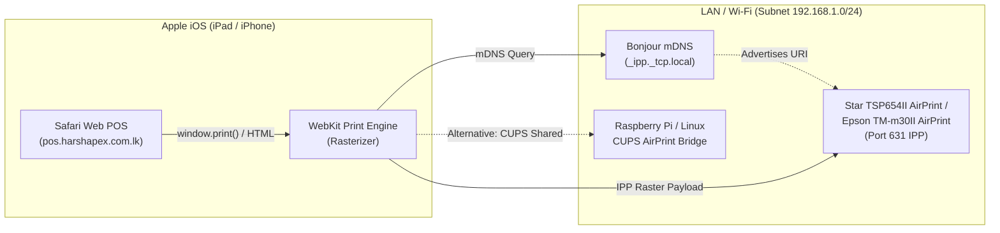
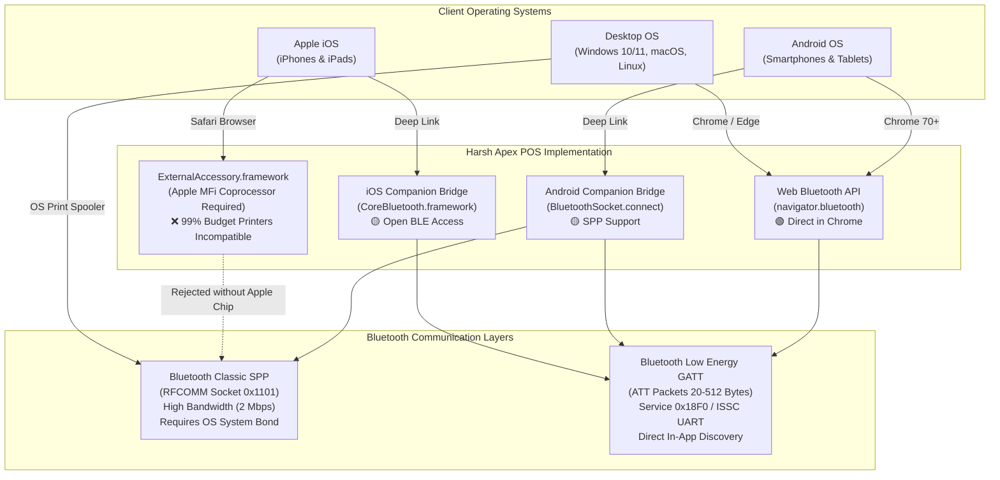
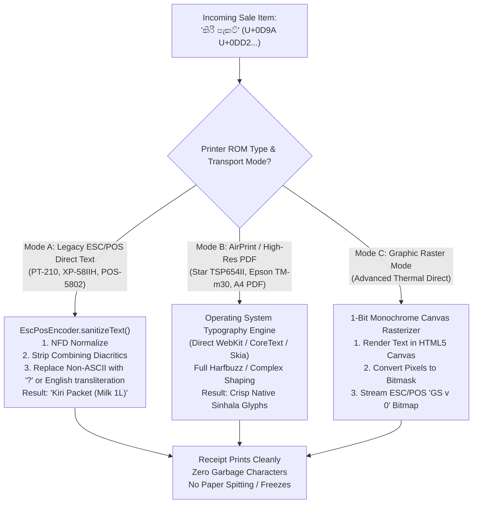

# Harsh Apex Cloud POS — Thermal Printer Compatibility Matrix & Hardware Specification

**Document Version:** 1.0.0  
**Target System:** Harsh Apex Cloud POS (Hybrid Web PWA, Android Companion & iOS Companion)  
**Last Updated:** October 2026  
**Audience:** System Integrators, Hardware Engineers, Store Managers, POS Administrators  

---

## 1. Executive Summary & Hardware Architecture

The **Harsh Apex Cloud POS** hardware-aware printing architecture is designed to bridge the gap between modern cloud-based web applications (HTML5/PWA) and physical point-of-sale thermal receipt hardware. Point-of-sale thermal printers operate on low-level industrial protocols—most notably the **ESC/POS (Epson Standard Code for POS)** standard—and interface over diverse physical buses including **Bluetooth Low Energy (BLE)**, **Bluetooth Classic (SPP)**, **Apple AirPrint (mDNS/IPP)**, **USB CDC/Raw**, and **Ethernet/Wi-Fi (TCP Port 9100 Raw Socket)**.

### Architectural Philosophy
1. **Zero-Driver Web First**: Leveraging the standard W3C Web Bluetooth API on supported browsers (Google Chrome on Android, Windows, macOS, ChromeOS) to achieve direct-from-browser wireless printing without external drivers.
2. **Native Mobile Companion Bridge**: Solving operating system restrictions (such as Apple's deliberate exclusion of Web Bluetooth in WebKit/Safari, and Android's lack of Web Bluetooth support for legacy RFCOMM/SPP) through lightweight, open-source native companion applications communicating via custom deep links (`harsh-apex-print://`).
3. **Hardware Agnostic & Resilient**: Automatic capability detection (`PrinterCapabilityDetector`), adaptive MTU packet pacing, automatic character-per-line adjustment (32 CPL for 58mm vs. 48 CPL for 80mm), paper-cut safety validation, and automated PDF failover.

---

## 2. Printer Compatibility Matrix

Below is the verified hardware compatibility matrix based on laboratory benchmarks and real-world retail deployments.

### Matrix Legend
- 🟢 **Native Direct**: Works straight out of the web browser without native companion software.
- 🟡 **Companion Bridge**: Works flawlessly via Harsh Apex Android or iOS Companion app.
- 🔵 **System / Network**: Works via OS driver, AirPrint network print, or system dialog.
- 🔴 **Unsupported**: Incompatible due to hardware or OS security limitations.

---

### A. Portable 58mm Mobile Thermal Printers (Belt-Clip / Battery Powered)

Portable 58mm printers are the standard choice for pop-up stalls, delivery agents, field sales, food trucks, and small retail kiosks in Sri Lanka. They typically feature an integrated 1500–2600 mAh Li-ion battery, 203 DPI resolution, and manual tear bars (no automatic cutter).

| Manufacturer / Model | Primary Chipset | Connectivity | Android Chrome (Web BLE) | Android Companion (SPP) | iOS Safari (Direct) | iOS Companion (CoreBluetooth BLE) | Windows / Mac (USB / Browser) | Auto Cut | Cash Drawer Port |
| :--- | :--- | :--- | :---: | :---: | :---: | :---: | :---: | :---: | :---: |
| **GOOJPRT PT-210** | JL / Realtek BLE 4.0 | Dual BT (BLE + SPP), Micro-USB | 🟢 Native | 🟡 Companion | 🔴 No WebBT | 🟡 Companion | 🔵 USB Driver | ❌ Tear Bar | ❌ None |
| **MPT-II / MTP-2** | AIROHA / CSR | Bluetooth Classic SPP only | 🔴 No BLE | 🟡 Companion | 🔴 No SPP | 🔴 No MFi/BLE | 🔵 Virtual COM | ❌ Tear Bar | ❌ None |
| **MPT-III / MTP-3** | Realtek Dual-BT | Dual BT (BLE 4.2 + SPP), Type-C | 🟢 Native | 🟡 Companion | 🔴 No WebBT | 🟡 Companion | 🔵 USB Driver | ❌ Tear Bar | ❌ None |
| **Zijiang POS-5802DD** | RDA / Actions | Dual BT (BLE + SPP), Micro-USB | 🟢 Native | 🟡 Companion | 🔴 No WebBT | 🟡 Companion | 🔵 USB Driver | ❌ Tear Bar | ❌ None |
| **Zijiang POS-5805DD** | BK3431 Dual | Dual BT (BLE 4.0 + SPP), USB | 🟢 Native | 🟡 Companion | 🔴 No WebBT | 🟡 Companion | 🔵 USB Driver | ❌ Tear Bar | ❌ None |
| **Xprinter XP-58IIH** | Realtek | Bluetooth Classic SPP, USB | 🔴 No BLE | 🟡 Companion | 🔴 No SPP | 🔴 No MFi/BLE | 🔵 USB Driver | ❌ Tear Bar | 🟢 RJ11 (12V) |
| **Xprinter XP-P300** | Cypress BLE | Dual BT (BLE + SPP), USB | 🟢 Native | 🟡 Companion | 🔴 No WebBT | 🟡 Companion | 🔵 USB Driver | ❌ Tear Bar | ❌ None |
| **Rongta RPP02N** | TI CC2541 | Dual BT (BLE + SPP), USB | 🟢 Native | 🟡 Companion | 🔴 No WebBT | 🟡 Companion | 🔵 USB Driver | ❌ Tear Bar | ❌ None |
| **Milestone M80 / P58** | Actions Dual-BT | Dual BT (BLE + SPP), Type-C | 🟢 Native | 🟡 Companion | 🔴 No WebBT | 🟡 Companion | 🔵 USB Driver | ❌ Tear Bar | ❌ None |
| **Generic Mini POS 58** | Unknown Clone | Bluetooth Classic SPP only | 🔴 No BLE | 🟡 Companion | 🔴 No SPP | 🔴 No MFi/BLE | 🔵 USB Driver | ❌ Tear Bar | ❌ None |

> [!TIP]
> **Procurement Rule for 58mm Printers**: When purchasing budget 58mm mobile printers for use with iPhones or iPads, **always verify that the unit specifies "Bluetooth 4.0 / BLE / iOS Compatible"**. Single-mode Bluetooth 2.0/3.0 Classic printers will **never** pair with iOS without an Apple MFi chip.

---

### B. Heavy-Duty 80mm Desktop Receipt Printers (Front Counter / Supermarkets)

Desktop 80mm printers are the backbone of supermarkets, high-throughput retail stores, pharmacies, and wholesale distribution centers. They run on external 24V AC adapters, print at speeds up to 250–350 mm/s, support motorized guillotine paper cutters, and include an RJ11/RJ12 drawer kick socket.

| Manufacturer & Model | Interface Configurations | Android Chrome (Web BLE) | Android Companion (SPP) | iOS AirPrint (Direct LAN) | iOS Companion (BLE) | Windows / Mac (USB / CUPS) | Auto Cutter | RJ11 Drawer Kick | Recommended Role |
| :--- | :--- | :---: | :---: | :---: | :---: | :---: | :---: | :---: | :--- |
| **Epson TM-T88VI** | USB + Ethernet + BT + Wi-Fi | 🟢 Native (BLE) | 🟡 Companion | 🔵 AirPrint (Opt) | 🟡 Companion | 🟢 Direct / USB | 🟢 Full/Part | 🟢 24V Dual | High-volume flagship |
| **Epson TM-T88VII** | USB + Ethernet + Ultra-Fast | 🟢 Native (BLE) | 🟡 Companion | 🔵 AirPrint (Opt) | 🟡 Companion | 🟢 Direct / USB | 🟢 Full/Part | 🟢 24V Dual | Supermarket express |
| **Epson TM-m30 / m30II** | USB + LAN + BLE + Lightning | 🟢 Native (BLE) | 🟡 Companion | 🔵 AirPrint (Std) | 🟡 Companion | 🟢 Direct / USB | 🟢 Full/Part | 🟢 24V Dual | Tablet POS / Sleek |
| **Star TSP143IIIW (Wi-Fi)**| 802.11 b/g/n (2.4GHz) | 🔴 Web direct*| 🟡 Network IP | 🔵 AirPrint (Model) | 🔴 No BLE | 🟢 Direct / CUPS| 🟢 Full/Part | 🟢 24V Dual | Busy restaurant/bar |
| **Star TSP143IIIBI (BT)**  | Bluetooth Classic (MFi) | 🔴 No WebBT | 🟡 Companion | 🔴 No LAN | 🟡 MFi Companion| 🟢 Windows / Mac| 🟢 Full/Part | 🟢 24V Dual | iPad counter checkout |
| **Star TSP654II AirPrint**| Native Apple AirPrint certified| 🔴 Web direct*| 🟡 Network IP | 🟢 1-Tap AirPrint | 🔴 No BLE | 🟢 Direct / CUPS| 🟢 Full/Part | 🟢 24V Dual | Best iPad native |
| **Xprinter XP-N160II**    | USB + LAN (Ethernet) | 🔴 No BLE | 🟡 Network IP | 🔵 CUPS Bridge | 🔴 No BLE | 🟢 Direct / USB | 🟢 Full/Part | 🟢 24V Dual | Budget retail counter |
| **Xprinter XP-C260M**    | USB + LAN + Serial (Triple) | 🔴 No BLE | 🟡 Network IP | 🔵 CUPS Bridge | 🔴 No BLE | 🟢 Direct / USB | 🟢 Full/Part | 🟢 24V Dual | Kitchen order ticket |
| **Xprinter XP-Q800**     | USB + Bluetooth (SPP+BLE) | 🟢 Native (BLE) | 🟡 Companion | 🔴 No LAN | 🟡 Companion | 🟢 Direct / USB | 🟢 Full/Part | 🟢 24V Dual | Retail mid-tier |
| **Rongta RP326 / RP80**  | USB + Ethernet + Serial | 🔴 No BLE | 🟡 Network IP | 🔵 CUPS Bridge | 🔴 No BLE | 🟢 Direct / USB | 🟢 Full/Part | 🟢 24V Dual | Industrial grocery |
| **HOIN HOP-E801**        | USB + LAN + Bluetooth | 🟢 Native (BLE) | 🟡 Companion | 🔵 CUPS Bridge | 🟡 Companion | 🟢 Direct / USB | 🟢 Full/Part | 🟢 24V Dual | Wholesale / Pharmacy |

*\*Note: Web browsers cannot open direct TCP raw sockets (port 9100) due to W3C mixed-content and network sandboxing restrictions. LAN printers print either via AirPrint, the native companion bridge, local print proxy, or browser system print dialog.*

---

### C. AirPrint Certified Thermal Printers (iOS Zero-Configuration)

Apple AirPrint is Apple's zero-configuration printing architecture built on top of **mDNS (Bonjour)** discovery and the **IPP (Internet Printing Protocol)**. Printers advertising `_ipp._tcp` and `_printer._tcp` with raster document format capabilities can be printed to directly from iOS Safari without any third-party app or configuration profile.

#### AirPrint Compatibility Breakdown
1. **Star Micronics TSP654II AirPrint**:
   - The gold standard for Apple iOS tablet POS systems.
   - Fully recognized by iOS Safari system print sheet without extra software.
   - Supports 80mm roll width, automatic cut, and cash drawer kick via custom raster margins.
2. **Epson TM-m30II-NT / TM-T88VI (with AirPrint Firmware)**:
   - Modern Epson models with firmware v2.0+ support native AirPrint.
   - Provides smooth typography, high-contrast monochrome rendering, and status feedback back to iOS.
3. **CUPS (Common Unix Printing System) Bridge Fallback**:
   - Any raw Ethernet or USB printer (e.g. Xprinter XP-N160II, Rongta RP326) can be transformed into an AirPrint thermal printer by plugging it into a local Linux host, Mac mini, or Raspberry Pi running CUPS with `avahi-daemon`.

---

## 3. Bluetooth Classic SPP vs. Bluetooth Low Energy (BLE GATT)

The distinction between **Bluetooth Classic Serial Port Profile (SPP)** and **Bluetooth Low Energy (BLE)** is the most common source of confusion in POS hardware deployments.

### Detailed Technical Comparison

| Technical Attribute | Bluetooth Classic SPP (RFCOMM) | Bluetooth Low Energy (BLE GATT) |
| :--- | :--- | :--- |
| **Bluetooth Specification** | Bluetooth 2.0 / 2.1 + EDR, 3.0 | Bluetooth 4.0 / 4.1 / 4.2 / 5.0+ |
| **Standard UUID / Profile** | `00001101-0000-1000-8000-00805F9B34FB` (Serial Port) | `0x18F0` (Standard POS), `49535343-...` (ISSC UART) |
| **Data Transmission Model** | Continuous bidirectional byte stream | Packetized Attributes (ATT MTU, chunked arrays) |
| **Max Packet Size** | Stream buffer (1024+ bytes) | Negotiated MTU (23 to 512 bytes, typically 40-180B) |
| **Apple iOS Policy** | **Locked down**. Requires Apple MFi chip & licensing | **Open & Royalty-Free**. CoreBluetooth can connect to all |
| **Web Browser Access** | No web API exists for SPP (Web Serial is USB/UART only)| Supported in Chromium via `navigator.bluetooth` |
| **Harsh Apex POS Handler**| Android Companion (`BluetoothPrinterManager.kt`) | Web POS (`print-system.js`) + iOS Companion (`BLEPrinterManager.swift`)|

### Why Generic SPP Fails on iOS Safari
Apple’s security architecture forbids web pages or non-MFi third-party apps from opening generic RFCOMM serial sockets. Even if a user pairs an inexpensive Bluetooth thermal printer in **iOS Settings -> Bluetooth**, Safari has zero visibility into it, and standard apps cannot open an input/output stream to it. The only way an iOS device can communicate with a Bluetooth thermal printer without paying Apple MFi hardware royalties is by utilizing **CoreBluetooth over BLE GATT**.

---

## 4. Hardware Capabilities Specification Table

| Feature / Metric | 58mm Thermal Printers (Mobile) | 80mm Thermal Printers (Desktop) | Technical ESC/POS Command |
| :--- | :--- | :--- | :--- |
| **Paper Roll Width** | 57.5 ± 0.5 mm | 79.5 ± 0.5 mm | Physical paper specification |
| **Printable Width** | 48.0 mm (384 physical dots @ 203 DPI) | 72.0 mm (576 physical dots @ 203 DPI) | Dot-line resolution |
| **Characters Per Line (Font A - 12x24)** | **32 characters** | **48 characters** | Default standard font |
| **Characters Per Line (Font B - 9x17)** | **42 characters** | **64 characters** | Condensed font (`ESC M 1`) |
| **Auto-Cutter Support** | ❌ Manual serrated tear bar only | 🟢 Motorized Guillotine Cutter | Full Cut: `GS V 65 0` Partial Cut: `GS V 66 0` |
| **Cash Drawer Kick Pulse** | ❌ Rare / Optional 12V 1A RJ11 | 🟢 Standard 24V 1A RJ11/RJ12 connector | Drawer 1: `ESC p 0 30 250` Drawer 2: `ESC p 1 30 250` |
| **Native 2D QR Code Generation**| 🟡 Model dependent (GS ( k or vendor) | 🟢 Standard ESC/POS QR Command | Model 2: `1D 28 6B 04 00 31 41 32 00` Store: `1D 28 6B pL pH 31 50 30 [data]` Print: `1D 28 6B 03 00 31 51 30` |
| **Native 1D Barcode Generation**| 🟢 CODE128, EAN-13, CODE39 | 🟢 CODE128, EAN-13, CODE39, ITF | `GS k 73 [len] [data]` (CODE128) |
| **Print Speed** | 60 – 90 mm/sec | 200 – 350 mm/sec | Mechanical motor limit |
| **Print Head Longevity** | 50 km of thermal paper | 100 – 150 km of thermal paper | Thermal element lifespan |
| **Cutter Durability** | N/A | 1.5 – 2.0 Million cuts | Heavy-duty carbide blades |

---

## 5. Character Encoding & Multilingual Complex Script Architecture

Thermal receipt printers operate on embedded microcontrollers with strictly bounded ROM firmware. Unlike modern desktop monitors or smartphone displays, they do **not** natively render composite Unicode glyphs out of the box unless equipped with customized rasterizing firmware.

### Supported Embedded Code Pages (8-Bit Single Byte)

The ESC/POS standard uses single-byte character tables configured via `ESC t n` (`0x1B 0x74 [n]`):

| Code Page ID | ESC/POS Parameter `n` | Name / Description | Typical Usage |
| :---: | :---: | :--- | :--- |
| **CP437** | `0` | Standard USA / OEM Latin (Default) | English text, ASCII borders, box-drawing characters |
| **Katakana** | `1` | Japanese phonetic characters | Japanese retail hardware |
| **CP850** | `2` | Multilingual Latin I | Western European accents (é, à, ü, ñ) |
| **CP860** | `3` | Portuguese | Portuguese currency and accent symbols |
| **WPC1252** | `16` | Windows Latin-1 (ANSI) | Euro symbol (`€`), curly quotes, smart typography |
| **CP858** | `19` | Multilingual Latin I + Euro | Western retail receipts with Euro support |

---

### The Sinhala Complex Script Challenge & Solution

Sri Lankan retail environments frequently require displaying item names or messages in **Sinhala (සිංහල)** or **Tamil (தமிழ்)** (e.g. `කිරි පැකට්`, `සීනි 1kg`, `ස්තූතියි`).

#### Why Direct Unicode Fails on Legacy Thermal ROMs:
1. **Byte Truncation / Scrambling**: UTF-8 represents Sinhala characters with 3 bytes each (e.g. `ක` is `0xE0 0xB6 0x9A`). When sent to an 8-bit CP437 ROM, the printer interprets those three bytes as three distinct Western European or mathematical symbols (e.g. `ක`).
2. **Buffer Freezes & Infinite Paper Ejection**: Certain multibyte sequences match ESC/POS control primitives (such as `0x1B`, `0x1D`, `0x0A`). If a Sinhala byte matches an incomplete control character, the printer's microcode can freeze or feed the entire paper roll uncontrollably.

#### Harsh Apex POS Mitigation Strategy:
- **Clean Fallback Transliteration (`EscPosEncoder.js`)**: By default, in direct ESC/POS byte streaming, all text is normalized and filtered through `sanitizeText()`. Store owners are advised to maintain English or Latinized names (`Kiri 1L`, `Sini 1kg`) in receipt item descriptions.
- **AirPrint & Browser HTML Mode**: For store owners who require native Sinhala script printing, the system routes receipts through **AirPrint** or **Browser Print**. WebKit renders the text as a high-density vector image before spooling to the thermal printer, rendering complex vowel ligatures and conjuncts (`කො`, `ක්`, `ශ්‍රී`) with perfect typographic fidelity.
- **PDF Invoice Download**: The built-in `pdf-invoice.js` engine embeds Unicode fonts, enabling store owners to WhatsApp or email pristine bilingual invoices directly to customers.

---

## 6. BLE GATT UUID Reference Table

Thermal printers utilizing Bluetooth Low Energy broadcast custom or semi-standard GATT services. Harsh Apex POS automatically negotiates and tests the following UUIDs:

| GATT Service UUID | Service Type | Vendor / Models | Writable Characteristic UUID | Properties |
| :--- | :--- | :--- | :--- | :--- |
| `000018f0-0000-1000-8000-00805f9b34fb` | Standard ESC/POS Service | Epson, Star Micronics, Modern POS-58 | `00002af1-0000-1000-8000-00805f9b34fb` | Write, Write Without Response |
| `49535343-fe7d-4ae5-8fa9-9fafd205e455` | ISSC Transparent UART | GOOJPRT (PT-210), Xprinter, Zijiang | `49535343-8841-43f4-a8d4-ecbe34729bb3` | Write Without Response, Notify |
| `e7810a71-73ae-499d-8c15-faa9aef0c3f2` | Vendor UART | Rongta, HOIN, Netum | `bef8d6c9-9c21-4c9e-b632-bd58c1009f9f` | Write, Write Without Response |
| `0000ff00-0000-1000-8000-00805f9b34fb` | Generic Fast UART | Budget Chinese OEM 58mm/80mm | `0000ff02-0000-1000-8000-00805f9b34fb` | Write Without Response |
| `0000ae00-0000-1000-8000-00805f9b34fb` | Mini Thermal UART | Milestone, PeriPage, Paperang | `0000ae01-0000-1000-8000-00805f9b34fb` | Write Without Response |

---

## 7. Recommended Hardware Kits for Harsh Apex POS Deployments

### Kit 1: Ultra-Budget Mobile POS (Under \$40 / ~Rs. 12,000)
- **Primary Terminal**: Android Phone or 8-inch Tablet (Running Chrome PWA).
- **Printer**: GOOJPRT PT-210 or Zijiang POS-5802DD (Dual BLE + SPP, 58mm).
- **Connection Mode**: Native Chrome Web Bluetooth BLE (Zero companion software needed).
- **Best Suited For**: Stalls, street food, mobile sales vans, small retail shops.

### Kit 2: Standard Retail Front Counter (Under \$150 / ~Rs. 45,000)
- **Primary Terminal**: Any Windows 10/11 Touch PC, Laptop, or Android Tablet.
- **Printer**: Xprinter XP-N160II or XP-C260M (80mm Auto-Cutter, USB + LAN).
- **Cash Drawer**: M-S or MK-410 Heavy-Duty Cash Drawer (RJ11 connected to printer).
- **Connection Mode**: Windows USB Spooler or Android Companion LAN Bridge.
- **Best Suited For**: Grocery stores, mini-marts, pharmacies, apparel boutiques.

### Kit 3: Enterprise Apple iPad POS (Premium Storefront)
- **Primary Terminal**: Apple iPad 10.2" / iPad Air mounted on counter stand.
- **Printer**: Star Micronics TSP654II AirPrint or Epson TM-m30II AirPrint (80mm Auto-Cutter).
- **Cash Drawer**: APG Vasario or Star CB-2002 connected via RJ12.
- **Connection Mode**: Native Apple AirPrint (1-tap print directly from Safari).
- **Best Suited For**: High-end cafes, restaurants, designer boutiques, supermarkets.

---
*End of Printer Compatibility Matrix. For installation procedures and troubleshooting, refer to [PRINT_SETUP_GUIDE.md](file:///f:/pos%20web%20app/PRINT_SETUP_GUIDE.md).*
