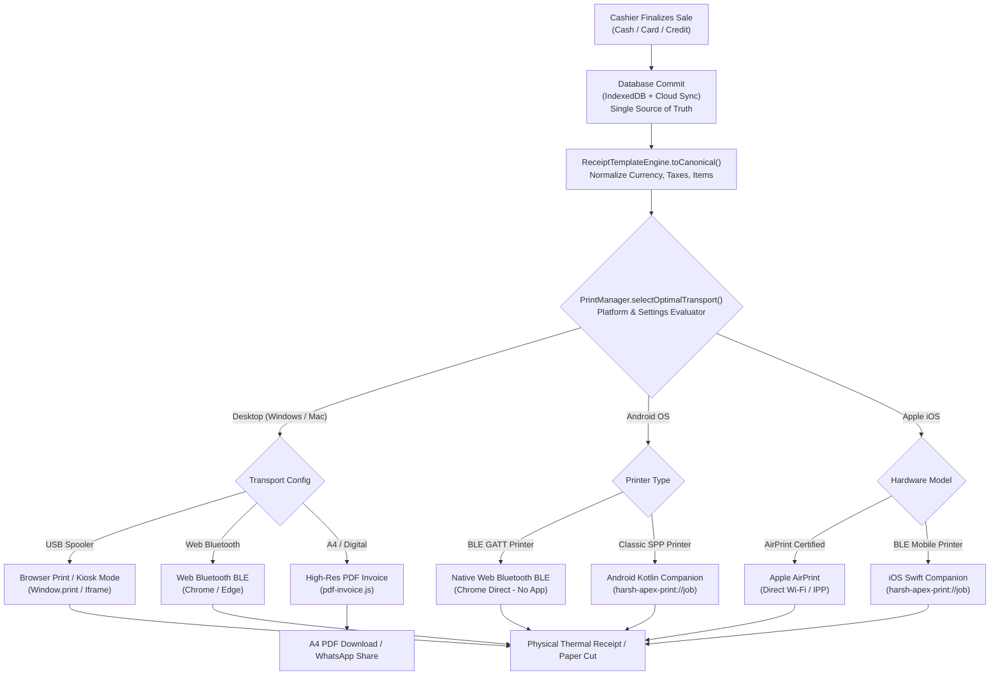
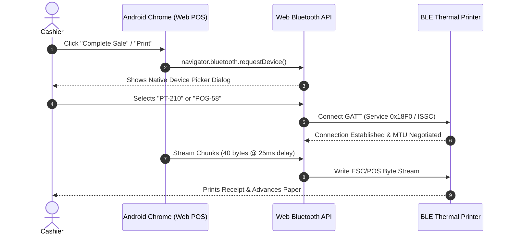
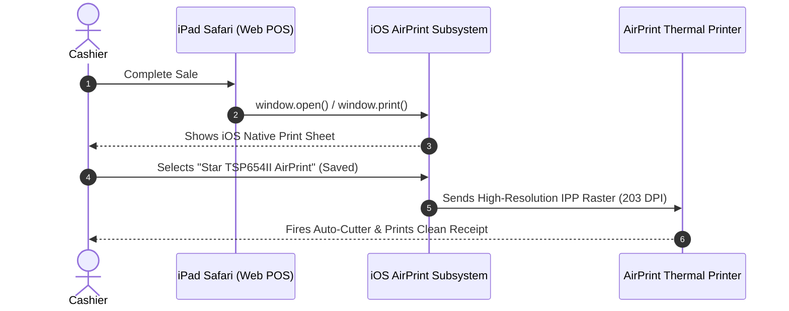
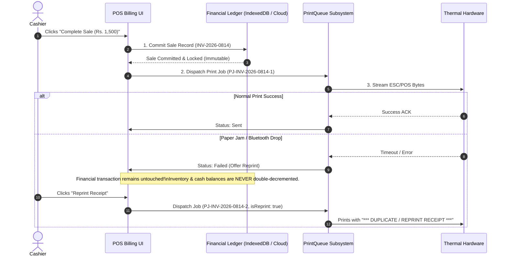

# Harsh Apex Cloud POS — Hardware Print Setup & Operational Guide

**System Version:** 1.0.0  
**Target Environments:** Desktop (Windows/macOS), Mobile (Android & iOS)  
**Supported Protocols:** Web Bluetooth (BLE), Apple AirPrint, Native Companion Deep Links, System Spooler, PDF Invoice  
**Last Updated:** October 2026  

---

## 1. Architecture & Print Pipeline Overview

The **Harsh Apex Cloud POS** print architecture decouples high-level retail billing transactions from low-level physical receipt output. Regardless of whether an operator is using a desktop workstation, an Android tablet, or an iPad, the system routes the receipt data through a unified hardware abstraction layer.



---

## 2. Desktop & Laptop Setup Guide (Windows & macOS)

Desktop environments support three primary printing modes:
1. **USB Thermal Printer with Browser Print Spooler** (Most reliable for stationary cash counters).
2. **Web Bluetooth BLE** (Direct wireless pairing via Google Chrome or Microsoft Edge).
3. **High-Resolution PDF Invoices** (Ideal for B2B wholesale, credit customers, or A4 printers).

---

### A. USB Thermal Printer Setup (Windows 10 / 11)

#### Step 1: Physical Connection & Driver Installation
1. Connect the thermal printer to the PC via USB and power it on.
2. Insert the vendor driver disk or download the driver for your printer family:
   - **Xprinter**: Install `Xprinter 80 Series Driver` or `Xprinter 58 Series Driver`.
   - **Epson**: Install `Epson Advanced Printer Driver (APD)`.
   - **Generic / OEM 58mm**: Use the `POS-58 Windows Driver` or select **Generic / Text Only**.
3. Open **Windows Settings -> Bluetooth & devices -> Printers & scanners**.
4. Confirm your printer appears (e.g., `POS-80` or `EPSON TM-T88VI Receipt`).
5. Right-click the printer -> **Printer properties -> Device Settings**:
   - Set **Paper Size** to `80 x 297 mm` (for 80mm) or `58 x 297 mm` (for 58mm).
   - Set **Cash Drawer** (if connected) to **Open before printing** or rely on ESC/POS kick pulses.
   - Set **Cutter** to **Cut at end of page**.

#### Step 2: Configure Harsh Apex POS
1. Launch **Google Chrome** or **Microsoft Edge** and log into Harsh Apex POS (`pos.html`).
2. Click **Settings (Gear Icon)** in the top navigation bar.
3. In the **Printer Settings** modal:
   - **Print Transport**: Select `Browser Print Dialog` or `Auto`.
   - **Paper Width**: Select `80mm` (48 columns) or `58mm` (32 columns).
   - **Auto-Print on Bill Finalize**: Enable if you want receipts to trigger instantly.
   - Click **Save Settings**.
4. Perform a transaction or click **Test Print**.
5. In the Chrome print preview dialog:
   - **Destination**: Choose your thermal printer.
   - **Margins**: Set to **None**.
   - **Options**: Uncheck **Headers and footers**.
   - Click **Print**. (Chrome remembers these settings for future prints).

#### Step 3: Enable Unattended Kiosk Printing (Optional - Ultra Fast)
To bypass the Chrome print preview modal entirely and print receipts immediately when the cashier clicks "Complete Sale":
1. Close all running instances of Google Chrome.
2. Right-click your Chrome desktop shortcut -> **Properties**.
3. In the **Target** field, append the `--kiosk-printing` flag after `chrome.exe`:
   ```text
   "C:\Program Files\Google\Chrome\Application\chrome.exe" --kiosk-printing
   ```
4. Click **Apply** and relaunch Chrome using this shortcut.
5. In Harsh Apex POS, toggle **Auto-Print on Bill Finalize: ON**. Receipts will now print silently in under 0.5 seconds without prompting the operator.

---

### B. Desktop Web Bluetooth BLE Setup (Windows & macOS)

For desktop workstations equipped with a Bluetooth 4.0+ adapter:
1. Turn on the BLE thermal printer (e.g., GOOJPRT PT-210, Epson TM-m30).
2. Open Harsh Apex POS in **Google Chrome**.
3. Open **Printer Settings** -> Select **Web Bluetooth (BLE GATT)**.
4. Click **Pair Bluetooth Printer**.
5. A Chrome browser permission prompt appears listing discovered BLE devices.
6. Select your printer (e.g. `MPT-III`, `Printer001`, or `POS-58`) and click **Pair**.
7. Click **Test Print**. ESC/POS bytes are streamed directly over BLE without operating system print drivers.

---

### C. A4 PDF Invoice Generation Setup

When dealing with institutional buyers, B2B wholesale transactions, or warranty items:
1. In Harsh Apex POS, set the print transport to **PDF Invoice Download**.
2. Completing a sale automatically invokes `pdf-invoice.js`, producing a vector A4 PDF containing:
   - Official Store Header, Address, Business Registration Number (BRN).
   - Itemized tabular breakdown with item descriptions, unit rates, quantities, and totals.
   - Financial totals in Sri Lankan Rupees (`Rs.`), tax summaries, discounts, and payment terms.
   - Unique verification QR code and authorized signatory line.
3. The PDF is saved locally to the downloads directory and can be printed to standard laser/inkjet printers or attached to WhatsApp/Email.

---

## 3. Android Setup Guide (Smartphones & Tablets)

Android is the premier operating system for mobile retail point-of-sale setups. Harsh Apex POS provides two distinct operation modes:
- **Mode 1: Pure Browser Direct via Chrome Web Bluetooth (BLE)** (Zero app installation required).
- **Mode 2: Native Android Companion App (Kotlin)** (For legacy Bluetooth Classic SPP printers).

---

### Mode 1: Pure Browser Direct via Web Bluetooth (BLE)

**Compatible Printers:** GOOJPRT PT-210, MPT-III, Zijiang POS-5802DD, Xprinter XP-P300, and all BLE 4.0+ thermal printers.



#### Step-by-Step Configuration:
1. **Enable Hardware Radios**:
   - Turn ON **Bluetooth** on your Android device.
   - Turn ON **Location (GPS)**. *(Mandatory on Android 6.0 through 11 for BLE device discovery due to Android OS security architecture).*
2. **Turn on the Thermal Printer**: Ensure the blue or green power LED is lit and the roll is loaded.
3. **Open Chrome & Launch Web POS**:
   - Navigate to `https://pos.harshapex.com.lk/pos.html` (or your local POS address).
4. **Configure Bluetooth in POS**:
   - Click the **Gear Icon** -> **Printer Settings**.
   - Set **Transport** to `Web Bluetooth (BLE GATT)`.
   - Set **Paper Width** to `58mm` (or `80mm` if using an 80mm mobile printer).
   - Click **Connect / Pair Device**.
5. **Grant Chrome Permissions**:
   - In the native Chrome popup, tap your printer name.
   - Tap **Pair**.
6. **Execute Diagnostic Print**:
   - Tap **Test Print**. The printer should instantly output the self-test receipt.

#### Android Chrome Flags (If Bluetooth Device Does Not Appear):
If Chrome does not discover your printer, open a new Chrome tab and configure:
1. Navigate to: `chrome://flags/#enable-web-bluetooth-new-permissions-backend` -> Set to **Enabled**.
2. Navigate to: `chrome://flags/#enable-web-bluetooth` -> Ensure set to **Default** or **Enabled**.
3. Tap **Relaunch** at the bottom of Chrome.

---

### Mode 2: Native Android Companion App (Bluetooth Classic SPP)

**When to Use:** When your printer only supports **Bluetooth 2.0 / 3.0 Classic (SPP)** (e.g. older Xprinter XP-58IIH, MPT-II, POS-5802 without BLE), or when you require uninterrupted background printing.

#### Step 1: Pair Printer with Android OS
1. Turn on the printer.
2. Go to Android **Settings -> Connected devices -> Pair new device**.
3. Select your printer (e.g. `XP-58`, `Bluetooth Printer`, `MPT-II`).
4. Enter the manufacturer PIN code: usually `0000` or `1234` (rarely `1111` or `8888`).
5. Confirm that the printer is now listed under **Saved devices** / **Paired devices**.

#### Step 2: Build & Install Android Companion App
The source code is located in `f:\pos web app\android-companion`.

```bash
# Navigate to project directory
cd "f:\pos web app\android-companion"

# Compile Debug APK using Gradle Wrapper
./gradlew assembleDebug

# Install directly to USB-connected Android device (with USB debugging ON)
./gradlew installDebug
```
*Alternatively, transfer `app/build/outputs/apk/debug/app-debug.apk` to your Android device via USB or WhatsApp and tap to install.*

#### Step 3: Grant Android Runtime Permissions
1. Open the **Harsh Apex POS Printer** companion app.
2. When prompted:
   - On **Android 12+ (API 31+)**: Allow **Nearby Devices** (`BLUETOOTH_CONNECT`, `BLUETOOTH_SCAN`). Location is not required.
   - On **Android 11 and lower**: Allow **Location Permission** (`ACCESS_FINE_LOCATION`) and keep GPS ON.
3. The companion app displays a list of paired Bluetooth devices.
4. Tap your printer name. The status chip turns **Green: Connected**.
5. Tap **Print Test Receipt** to verify the RFCOMM socket link.

#### Step 4: Link Web POS to Companion via Deep Link
1. In the Web POS **Printer Settings**:
   - Set **Transport** to `Native Android Companion (Classic SPP)`.
   - Set **Companion Scheme** to `harsh-apex-print://job`.
2. When a sale is completed, the web app triggers:
   ```text
   harsh-apex-print://job?id=HA-1042&ts=1792948200&token=apex-token-1792948200&width=58mm&payload=<BASE64_JSON>
   ```
3. Android immediately hands off the request to the companion app, which prints the receipt and automatically switches back to the browser.

---

## 4. iOS Setup Guide (iPhone & iPad)

Apple iOS requires specific architectural considerations because **iOS Safari does NOT support the Web Bluetooth API**. Harsh Apex POS provides two production-grade pathways for Apple devices:
- **Mode 1: Apple AirPrint Thermal Printing** (Zero configuration, uses existing Wi-Fi).
- **Mode 2: Native iOS Companion Swift App** (Uses CoreBluetooth BLE for portable mobile printers).

---

### Mode 1: Apple AirPrint Thermal Printing (Recommended for iPad Counters)

**Compatible Printers:** Star Micronics TSP654II AirPrint, Epson TM-m30II AirPrint, or any thermal printer shared via a CUPS print server on the local network.



#### Step-by-Step Setup:
1. Connect your AirPrint thermal printer to your store's Wi-Fi router (or connect via Ethernet cable to the Wi-Fi router).
2. Connect your iPad or iPhone to the **same Wi-Fi network**.
   > [!IMPORTANT]
   > Ensure **AP Isolation** or **Guest Mode Isolation** is turned **OFF** on your Wi-Fi router. Client devices must be permitted to communicate over local subnet ports 631 (IPP) and 5353 (mDNS).
3. Open **Safari** and navigate to your Harsh Apex POS.
4. Open **Printer Settings** -> Select **Apple AirPrint (Direct WiFi/LAN)**.
5. Set **Paper Width** to `80mm` (AirPrint thermal printers are almost universally 80mm).
6. Tap **Test Print**.
7. The native iOS AirPrint sheet opens.
   - Tap **Printer** -> Select your thermal printer from the list.
   - iOS remembers this printer selection for all subsequent prints.
8. Tap **Print**. The receipt is rendered with crisp vector typography, native Sinhala/Tamil fonts, and auto-cut.

---

### Mode 2: Native iOS Companion Swift App (For 58mm & 80mm BLE Printers)

**When to Use:** When operating an iPhone or iPad with an inexpensive portable Bluetooth printer (e.g. GOOJPRT PT-210, MPT-III, Rongta RPP02N) on battery power.

#### Step 1: Xcode Build & Deployment
The native iOS companion source code is located in `f:\pos web app\ios-companion`.

1. Open `HarshApexPrinter.xcodeproj` on a Mac running macOS 13+ with Xcode 14.3+:
   ```bash
   open "f:/pos web app/ios-companion/HarshApexPrinter.xcodeproj"
   ```
2. In the project navigator, select the root **HarshApexPrinter** target.
3. Under **Signing & Capabilities**:
   - Check **Automatically manage signing**.
   - Select your personal or organization **Apple Developer Team**.
   - If using a personal team, set a unique Bundle Identifier (e.g., `com.yourstore.HarshApexPrinter`).
4. Connect your physical iPhone or iPad via USB cable. *(Note: The Xcode Simulator cannot scan physical BLE devices; a real iPhone or iPad is required).*
5. Select your connected device as the build target in Xcode's top bar.
6. Press **Cmd + R** (Build and Run).
7. If prompted on your iPhone: Go to **Settings -> General -> VPN & Device Management** and trust your Developer certificate.

#### Step 2: Configure Companion & Connect Printer
1. Launch the **Harsh Apex Printer** app on your iPhone or iPad.
2. Tap **Allow** when prompted for **Bluetooth Permission**.
3. Turn on your thermal printer.
4. In the app's **Nearby BLE Devices** list, tap your printer name (e.g. `PT-210`).
5. The status chip updates to **Connected (GATT Active)**.
6. Tap **Diagnostic Test Print** to verify output.

#### Step 3: Trigger Receipts from Safari
1. Open **Safari** and navigate to Harsh Apex POS.
2. In **Printer Settings**, select **iOS Companion App (BLE / MFi)**.
3. Set **Companion Scheme** to `harsh-apex-print://job`.
4. When you complete a transaction, Safari deep links into the companion app:
   ```text
   harsh-apex-print://job?id=APX-901&ts=1792948200&token=apex-token-1792948200&width=58mm&payload=<BASE64_JSON>
   ```
5. The companion app validates the token, prints the receipt over BLE GATT in ~1 second, and displays a confirmation toast.

---

## 5. Comprehensive Troubleshooting Guide

| Issue / Error Symptom | Probable Root Causes | Exact Step-by-Step Resolution |
| :--- | :--- | :--- |
| **"Bluetooth device not found"** or Chrome says *"NotFoundError: User cancelled the request device chooser"* | 1. Printer is turned off or battery dead.<br>2. Printer is already connected to another smartphone or tablet.<br>3. Android Location (GPS) is turned OFF.<br>4. Printer is Bluetooth Classic only (no BLE support). | 1. Power cycle printer. Confirm blue status LED is blinking.<br>2. Disconnect Bluetooth on any other nearby phone or tablet (BLE printers typically allow only **one** master connection).<br>3. On Android <= 11, swipe down quick settings and turn **Location: ON**.<br>4. If printer lacks BLE, use the **Android Companion App** with Classic SPP. |
| **"GATT characteristic not writable"** or `SecurityError: Characteristic does not have write property` | 1. Printer GATT service requires `writeWithoutResponse` instead of standard `write`.<br>2. Selected non-writable diagnostic characteristic.<br>3. ATT MTU payload exceeded without packet pacing. | 1. Ensure `print-system.js` is up to date; it automatically tests `ch.properties.writeWithoutResponse`.<br>2. Verify service UUID matches: `0x18F0` or ISSC `49535343-...`.<br>3. Check pacing delay: In POS Printer Settings, set **BLE Chunk Size** to `40` bytes and **Write Delay** to `25` ms. |
| **"Paper cut not functioning"** (Receipt finishes but paper is not sliced) | 1. Printer is a 58mm mobile unit (no motorized cutter).<br>2. Cutter command variation (`GS V 66 0` vs `GS V 65 0` vs `GS V 1`).<br>3. Feed lines before cut is 0, cutting text in half. | 1. Confirm hardware: 58mm portable printers **do not have auto-cutters**; tear paper manually across the serrated teeth.<br>2. On 80mm printers, open POS Settings -> verify **Auto Cut Paper** is enabled.<br>3. Set **Feed Lines before cut** to `3` or `4` to ensure the final total and footer pass beyond the cutter blade. |
| **"Garbled / foreign characters printed"** (Printer spits unending lines of symbols, mathematical glyphs, or `ක`) | 1. Multibyte UTF-8 Sinhala/Tamil characters sent to an 8-bit CP437 ROM.<br>2. Serial / USB Baud rate mismatch (e.g. 9600 vs 115200).<br>3. Missing ESC/POS initialization sequence (`ESC @`). | 1. Keep receipt item descriptions in English/Latin text (`Kiri 1L`, `Sini 1kg`) or enable transliteration.<br>2. For native Sinhala script printing, switch to **AirPrint** or **Browser Print (HTML)** where WebKit vectorizes the text.<br>3. Ensure `enc.init()` (`0x1B 0x40`) is the very first byte sequence sent. |
| **"Print job queued but not printing"** | 1. Browser popup blocker stopped `window.open()`.<br>2. Printer cover is open or out of paper.<br>3. Print queue in browser state is stuck in `processing`. | 1. In browser address bar, click the **Pop-up blocked** icon -> choose **Always allow pop-ups from pos.harshapex.com.lk**.<br>2. Check printer LEDs: A red blinking LED indicates **Out of Paper** or **Cover Unlatched**.<br>3. Open POS Settings -> click **Clear / Reset Print Queue**. |
| **"Cash drawer does not kick open"** | 1. Cash drawer RJ11 cable plugged into phone port instead of printer DK port.<br>2. Voltage mismatch (12V drawer on 24V printer or vice versa).<br>3. Pulse pin duration too short. | 1. Ensure cable is plugged into the port marked **DK** (Drawer Kick) on the back of the thermal printer.<br>2. In settings, verify the drawer kick code is `ESC p 0 30 250` (Pin 2, 60ms on, 500ms off). |

---

## 6. Idempotency & Re-print Safety (Preventing Double Billing)

In a fast-paced retail checkout environment, paper jams, empty rolls, or communication drops can cause cashiers to press "Print" multiple times. Harsh Apex POS enforces strict architectural separation between **financial state mutations** and **hardware print jobs**.



### Key Safety Guarantees

1. **Transaction Immutability**:
   - The financial sale record (`sale.id`, payment details, stock deductions) is finalized and committed to the database **before** any print dispatch is attempted.
   - A printer hardware failure, out-of-paper error, or Bluetooth disconnection **never** cancels or duplicates the completed financial sale.
2. **Deterministic Canonical Nonces**:
   - Every print job receives a distinct identifier: `PJ-<ReceiptID>-<Timestamp>-<Nonce>`.
   - The native companion apps (Android & iOS) maintain a thread-safe **Anti-Replay Cache**:
     - Any duplicate request bearing the same `id` within a 300-second window is rejected with HTTP 409 / Toast Warning, preventing physical paper waste if a cashier double-taps the print button.
3. **Reprint Watermarking**:
   - When a receipt is reprinted from the historical sales ledger, the `isReprint: true` flag is enforced.
   - The printer prints a prominent header:
     ```text
     ================================
     *** DUPLICATE / REPRINT RECEIPT ***
     ================================
     ```
   - This prevents dishonest customers or staff from presenting a reprinted receipt to claim a second set of goods from warehouse dispatch.
4. **Local Audit Logging**:
   - Every print attempt, whether successful, failed, or fallback-routed, is recorded in `PrintQueue.logAudit()` and persisted to `localStorage.apex_pos_print_audit_log_v1`.
   - Store managers can inspect the audit log in the Admin Panel to verify all print dispatches against actual drawer cash balances.

---
*End of Hardware Print Setup Guide. For detailed device compatibility charts, refer to [PRINTER_COMPATIBILITY.md](file:///f:/pos%20web%20app/PRINTER_COMPATIBILITY.md).*
