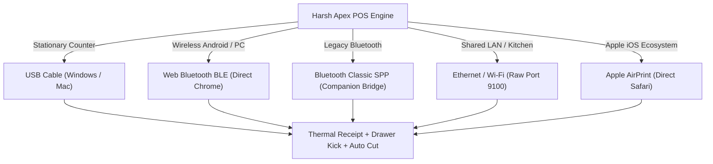

# Harsh Apex POS — Receipt Printer Setup & Troubleshooting Guide
**Universal Hardware Integration Manual for 58mm & 80mm Thermal Receipt Printers**

---

## 1. Thermal Printer Architecture Overview

Point-of-Sale thermal receipt printers use heat-sensitive paper and industrial **ESC/POS (Epson Standard Code for POS)** command protocols. Unlike standard inkjet or laser desktop printers, thermal printers do not use ink cartridges, ribbons, or toner.

Harsh Apex POS incorporates a hardware abstraction layer that supports all standard thermal communication buses:
1. **USB Spooler:** Direct cable connection on Windows PC / Mac with browser spooling.
2. **Web Bluetooth (BLE):** Direct browser wireless printing in Google Chrome (no driver or external app required).
3. **Bluetooth Classic (SPP):** Wireless serial connection via lightweight mobile companion bridge.
4. **Network (Ethernet RJ45 / Wi-Fi):** High-speed multi-terminal network printing via TCP Port 9100.
5. **Apple AirPrint:** Native Apple Bonjour/IPP wireless printing from iPhone & iPad.



---

## 2. Choosing Your Printer: 58mm vs. 80mm Comparison

| Feature | 58mm Mobile / Compact Thermal | 80mm Heavy-Duty Desktop Thermal |
| :--- | :--- | :--- |
| **Paper Roll Width** | 58 mm (2.28 inches) | 80 mm (3.15 inches) |
| **Printable Width** | 48 mm (384 dots @ 203 DPI) | 72 mm (576 dots @ 203 DPI) |
| **Characters Per Line** | **32 Characters** (Font A) | **48 Characters** (Font A) |
| **Paper Cutter** | Manual Serrated Tear Bar | **Motorized Guillotine Auto-Cutter** |
| **Cash Drawer Kick** | Usually none (or optional 12V RJ11) | **Standard 24V RJ11/RJ12 Port** |
| **Power Source** | Internal 1500–2600 mAh Li-ion Battery | 24V DC / 2.5A Mains Power Adapter |
| **Typical Speed** | 70 – 90 mm/sec | 200 – 300 mm/sec |
| **Best Used For** | Pop-up counters, delivery, food trucks, boutiques | Supermarkets, grocery stores, pharmacies, wholesale |

---

## 3. Windows PC Setup: USB Thermal Printers

Stationary desktop checkouts in Sri Lanka predominantly use USB-connected thermal printers such as **Xprinter (XP-N160II, XP-C260M, XP-58IIH)**, **Epson (TM-T88VI, TM-m30)**, or **Generic POS-58 / POS-80**.

### Step 1: Physical Connection & Driver Installation
1. Connect the USB cable between the printer and your Windows PC.
2. Connect the power adapter to a 230V AC socket and power the printer ON.
3. Install the manufacturer driver:
   - **Xprinter:** Run `Xprinter Driver Setup.exe` -> Select **USB** -> Select **XP-80C** (for 80mm) or **XP-58** (for 58mm) -> Click **Install**.
   - **Epson:** Run `Epson Advanced Printer Driver (APD)`.
   - **Generic / OEM 58mm:** Select **POS-58** or use Windows built-in `Generic / Text Only`.
4. Open Windows **Settings** -> **Bluetooth & devices** -> **Printers & scanners**.
5. Locate your newly installed printer (e.g. `POS-80` or `EPSON TM-T88VI`).
6. Click the printer -> Select **Printer properties** -> Open the **Device Settings** tab:
   - **Paper Size:** Select `80 x 297 mm` (for 80mm) or `58 x 297 mm` (for 58mm).
   - **Cutter:** Set to *Cut at end of document / page*.
   - **Cash Drawer:** Set to *Open before printing* or *Open after printing*.

---

### Step 2: Configure Harsh Apex POS
1. Open Harsh Apex POS in **Google Chrome**.
2. Click the **Settings (Gear Icon)** in the top navigation bar.
3. In the **Printer Settings** section:
   - **Print Mode:** Select `Browser Print / Windows Spooler`.
   - **Paper Width:** Select `80mm (48 Columns)` or `58mm (32 Columns)` matching your physical printer.
   - **Auto-Print on Bill Finalize:** Toggle **ON** if you want receipts to trigger immediately upon checkout.
4. Click **Save Settings**.
5. Click **"Test Print"**. The Chrome Print Preview window will appear.
6. **Critical Chrome Print Settings (One-Time Setup):**
   - **Destination:** Select your thermal printer (e.g. `POS-80`).
   - **Pages:** All.
   - **Paper Size:** `80 x 297 mm` (or `58 x 297 mm`).
   - **Margins:** Set strictly to **"None"**. *(Setting margins to "Default" causes clipped receipts).*
   - **Options:** **Uncheck** "Headers and footers". *(Prevents date, URL, and page numbers from printing).*
7. Click **Print**. Chrome permanently remembers these settings.

---

### Step 3: Enable Instant Kiosk Silent Printing
By default, Windows displays the print confirmation preview before printing. To bypass this dialog completely so receipts print immediately in under 0.5 seconds:
1. Close all active Google Chrome windows.
2. Right-click the **Harsh Apex POS** shortcut on your desktop -> Select **Properties**.
3. In the **Target** field, add a space after `chrome.exe` (or after `--app-id=...`) and paste:
   ```text
   --kiosk-printing
   ```
4. Example Target string:
   ```text
   "C:\Program Files\Google\Chrome\Application\chrome.exe" --app=https://pos.harshapex.com.lk --kiosk-printing
   ```
5. Click **Apply** -> **OK**.
6. Whenever you launch POS through this shortcut and complete a sale, your receipt will shoot out instantly without any user confirmation prompts.

---

## 4. Bluetooth Thermal Printer Setup (Android & Windows)

Bluetooth printers eliminate tangled cables on the checkout counter. Compatible models include **GOOJPRT PT-210**, **MPT-III**, **Zijiang POS-5802DD**, **Milestone M80**, and **Epson TM-m30II-NT**.

### Mode A: Web Bluetooth BLE Direct (Chrome on Android & Windows)
*Zero driver installation, zero external app installation.*

1. Turn on your Bluetooth thermal printer and ensure the blue Bluetooth LED is flashing.
2. Open Harsh Apex POS in **Google Chrome** on your Android device or Bluetooth-enabled PC.
3. Go to **Settings** -> **Printer Settings**.
4. Set **Print Transport** to `Web Bluetooth (BLE GATT)`.
5. Click **"Pair Bluetooth Printer"**.
6. Chrome will display a nearby device popup:
   - Select your printer from the list (common names: `MPT-III`, `PT-210`, `POS-58`, `Printer001`, `InnerPrinter`).
   - Click **Pair**.
7. If Android asks for a Bluetooth PIN, enter `0000` or `1234`.
8. Click **"Test Print"**. ESC/POS binary data will stream directly to the thermal printhead over Bluetooth Low Energy.

---

### Mode B: Bluetooth Classic (SPP) via Companion Bridge
*For older budget thermal printers that only support legacy Bluetooth 2.0/3.0 RFCOMM.*

1. Open your Android device's native **Settings** -> **Connected devices** -> **Pair new device**.
2. Pair with the thermal printer using PIN `0000` or `1234`.
3. Install the lightweight **Harsh Apex Android Companion** (available in the `android-companion/` folder or via APK download).
4. In Harsh Apex POS Settings, set **Print Transport** to `Android Companion App`.
5. Upon checkout, the POS invokes the deep link `harsh-apex-print://job`, sending the receipt data to the companion bridge, which writes raw ESC/POS bytes over the SPP socket.

---

## 5. Apple iOS / iPad Setup (AirPrint & Bluetooth)

Due to Apple security sandbox restrictions, Safari does not implement the experimental W3C Web Bluetooth API. Harsh Apex POS provides two seamless methods for iPad and iPhone users:

### Option 1: Apple AirPrint Certified Printers (Recommended for iPad)
1. Ensure your thermal receipt printer supports native Apple AirPrint (e.g., **Star Micronics TSP654II AirPrint**, **Epson TM-m30 AirPrint edition**, or standard network printers via CUPS).
2. Connect the printer to the same Wi-Fi network as your iPad.
3. In Harsh Apex POS, set **Print Transport** to `AirPrint / Safari Dialog`.
4. Upon clicking "Print Receipt", the standard iOS print sheet appears:
   - Select your AirPrint printer.
   - Tap **Print**. Receipts print crisp with automatic paper cutting.

### Option 2: Bluetooth Thermal via iOS Companion
1. For portable BLE thermal printers (e.g. GOOJPRT PT-210 BLE), install the **Harsh Apex iOS Companion** app (`ios-companion/`).
2. Pair the BLE printer inside the companion app.
3. In POS settings, select `iOS Companion Deep Link`.
4. When a sale completes, receipt jobs are handed off smoothly to the native companion via URL scheme.

---

## 6. Network Thermal Printers (Ethernet RJ45 & Wi-Fi)

For busy retail stores with multiple cashiers sharing one central invoice printer, or for restaurants printing order slips to the kitchen:

```
+---------------------------------------------------------------------------------+
|                               LOCAL AREA NETWORK (LAN)                          |
|                                                                                 |
|   +-------------------+    +-------------------+    +-----------------------+   |
|   | Counter 1 (PC)    |    | Counter 2 (Tablet)|    | Thermal LAN Printer   |   |
|   | 192.168.1.101     |    | 192.168.1.102     |    | Static: 192.168.1.200 |   |
|   +---------+---------+    +---------+---------+    +-----------+-----------+   |
|             |                        |                          |               |
|             +------------------------+--------------------------+               |
|                                      |                                          |
|                          Wi-Fi Router / Network Switch                          |
+---------------------------------------------------------------------------------+
```

### Configuration Steps
1. Connect the thermal printer to your Wi-Fi router using an Ethernet cable (RJ45).
2. **Obtain Printer IP Address:** Turn printer power OFF. Hold down the **FEED** button and switch power ON. Keep holding FEED for 3 seconds until the self-test receipt prints. Note the **IP Address** (e.g., `192.168.1.200`).
3. Set the printer IP to **Static** in your router settings to prevent DHCP address reassignment.
4. On your Windows PC, add the printer as a **Standard TCP/IP Port**:
   - Windows Settings -> **Printers & scanners** -> **Add device** -> **Add manually**.
   - Select **Add a printer using an IP address or hostname**.
   - Device type: `TCP/IP Device`.
   - Hostname or IP address: enter your printer IP (e.g. `192.168.1.200`). Port: `9100`.
   - Install the printer manufacturer driver.
5. All POS terminals on the local network can now print to this single shared receipt printer.

---

## 7. Cash Drawer & Auto-Cutter Setup

### Connecting the Cash Drawer (RJ11/RJ12)
1. Plug the cash drawer's RJ11 telephone-style cable into the **DK (Drawer Kick)** port on the back of the thermal printer (NOT the phone line!).
2. Ensure the drawer solenoid matches your printer voltage:
   - Heavy-duty 80mm printers supply **24V DC**.
   - Compact 58mm printers typically use **12V DC**.
3. **Automatic Kick on Sale:** When configured in Harsh Apex POS, the software transmits the ESC/POS kick pulse (`ESC p m t1 t2` / `\x1B\x70\x00\x19\xFA`) immediately before the receipt header prints, opening the drawer silently.

### Auto-Cutter Configuration
1. In 80mm printers with built-in motorized cutters, the POS sends the standard cut command (`GS V 66 0`).
2. Harsh Apex POS automatically appends **4 blank feed lines** before firing the cut blade. This ensures your store footer, thank-you note, and verification barcode are never sliced across the middle.

---

## 8. Detailed Troubleshooting & Solutions Matrix

| Issue Symptom | Probable Cause | Guaranteed Solution |
| :--- | :--- | :--- |
| **Printer feeds paper but prints totally BLANK** | Thermal roll is loaded upside-down. | **Thermal paper has heat coating on ONE side only.** Open the cover and perform the "Fingernail Scratch Test" (scratching the paper firmly with your fingernail leaves a black mark on the heat-sensitive side). Flip the roll so the coated side faces the thermal printhead. |
| **Right side of receipt is cut off or words wrap badly** | Paper width mismatch in settings. | Go to POS **Settings** -> **Printer Settings**. If using 58mm paper, select **`58mm (32 Columns)`**. If using 80mm paper, select **`80mm (48 Columns)`**. In Chrome print preview, ensure Margins are set to **None**. |
| **Date, URL, and page numbers print on receipts** | Chrome "Headers and footers" enabled. | In the Chrome print preview modal, expand **More settings** and **UNCHECK "Headers and footers"**. |
| **Sinhala text shows as `????` or gibberish** | Raw Unicode text sent to ASCII firmware. | **Harsh Apex POS uses Canvas Bitmap Rasterization.** Enable **"High-Quality Sinhala Canvas Mode"** in Printer Settings. The POS renders Sinhala ligatures (`ලංකා`, `රු.`, `මුදල්`) into a crisp monochrome bitmap before sending to the thermal printhead. |
| **Bluetooth printer not appearing in Chrome scan** | Printer paired to another device or Location disabled. | 1. Bluetooth allows only 1 active connection. Turn off Bluetooth on other phones nearby.<br>2. On Android, enable **Location** (required by Android OS for BLE scanning).<br>3. Power-cycle the printer.<br>4. Enter pairing PIN `0000` or `1234`. |
| **Faded or faint printouts** | Low battery or dirty thermal printhead. | 1. If battery-powered (58mm), plug in the AC charger.<br>2. Turn off printer, dampen a cotton swab with isopropyl alcohol, and gently clean the thermal line across the printhead.<br>3. Check paper roll quality (cheap thermal paper degrades in Sri Lankan humidity). |
| **Cash drawer does not kick open** | Wrong RJ11 pinout or voltage mismatch. | 1. Verify cable is plugged into the printer DK port, not a router/telephone socket.<br>2. In Windows printer properties -> Device Settings -> set Cash Drawer to "Open before print".<br>3. Verify drawer key is turned to the unlocked position! |
| **Printer beeps continuously (red error LED)** | Paper cover open or out of paper. | Open the lid, check paper roll orientation, close lid firmly until both latches click. |

---

## 9. Hardware Supplier Recommendations (Sri Lanka)

When purchasing receipt printers in Colombo, Kandy, Galle, or online via Daraz, look for these trusted models:
- **Best 80mm Countertop:** Xprinter XP-N160II (USB+LAN), Epson TM-T88VI, Rongta RP326.
- **Best 58mm Mobile Bluetooth:** GOOJPRT PT-210 (BLE 4.0), MPT-III Dual-Mode, Zijiang POS-5802DD.
- **Best iPad AirPrint:** Star Micronics TSP654II AirPrint, Epson TM-m30.
- **Paper Roll Specification:**
  - 80mm Rolls: 80mm x 70mm / 80mm x 80mm Thermal Paper.
  - 58mm Rolls: 57mm x 40mm / 57mm x 50mm Thermal Paper.
