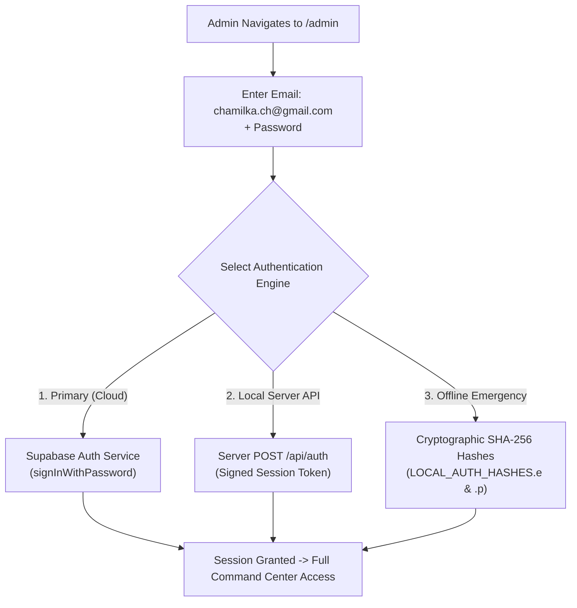
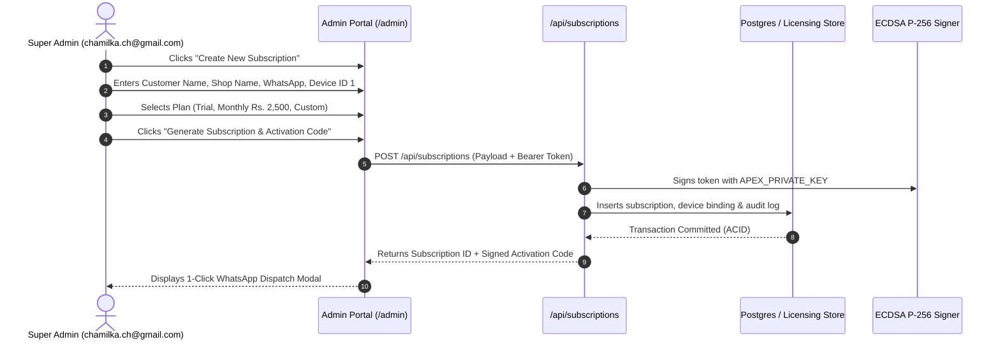
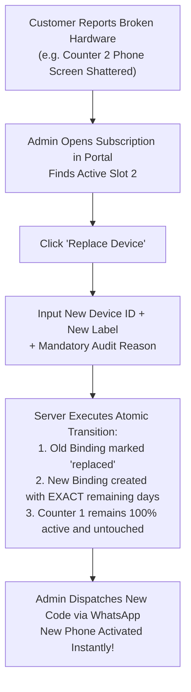

# Harsh Apex POS — Super Admin Operations Manual
**Executive SaaS Control Center Guide for System Administrator (`chamilka.ch@gmail.com`)**

---

## 1. System Governance & Access Control

The **Harsh Apex POS Command Center** provides centralized subscription provisioning, cryptographic license signing, multi-device hardware slot control, broken terminal swaps, payment bookkeeping, and immutable audit logs.

### Administrator Identity & Credentials
- **Authorized Super Administrator:** `chamilka.ch@gmail.com`
- **Access Endpoints:**
  - **Production Command Center:** [https://pos.harshapex.com.lk/admin](https://pos.harshapex.com.lk/admin) (or `/admin.html`)
  - **Local Development Server:** `http://localhost:3000/admin` (or `http://localhost:3000/admin.html`)
- **Session Duration:** 24-hour cryptographic bearer token stored in `sessionStorage` (`apex_admin_token`). Automatic renewal occurs on active administrative interaction.



---

## 2. Authentication & First-Time Setup Instructions

### Logging into the Command Center
1. Open your web browser (Google Chrome or Microsoft Edge recommended) and navigate to:
   ```text
   https://pos.harshapex.com.lk/admin
   ```
2. Enter your authorized administrator email:
   ```text
   chamilka.ch@gmail.com
   ```
3. Enter your secure master password.
4. Click **"Sign In to Command Center"**.
5. Upon successful authentication, the system loads the **Dashboard Overview** with real-time subscription metrics, revenue statistics, active hardware bindings, and the audit feed.

> [!TIP]
> **Emergency Offline Access:** In the unlikely event that Supabase or the cloud database is temporarily unreachable, the Command Center seamlessly falls back to the local `/api/auth` endpoint and encrypted local file store (`data/licensing.json`). You can continue provisioning licenses without downtime.

---

## 3. Subscription Provisioning & Plan Management

Harsh Apex POS supports three standard licensing tiers:

| Tier Name | Customer Fee | Valid Duration | Device Allocation | Billing Cycle |
| :--- | :---: | :---: | :---: | :--- |
| **7-Day Free Trial** | **Rs. 0 (Free)** | **7 Days** (604,800,000 ms) | Up to 2 Devices | Exactly 7 days from instant activation. |
| **Standard Monthly** | **Rs. 2,500 LKR** | **30 Days** (2,592,000,000 ms) | Up to 2 Devices | Recurring monthly upon bank slip verification. |
| **Custom Duration** | Negotiated / Annual | Exact Colombo Date/Time | Up to 2 Devices | Used for annual plans, extensions, or goodwill credits. |

---

### A. Creating a New Customer Subscription



#### Step-by-Step Procedure:
1. In the Command Center, switch to the **"Customers"** or **"Licenses"** tab.
2. Click the top button: **"+ Create New Subscription"**.
3. Fill in the Customer Profile form:
   - **Customer Name:** Full name of shop owner (e.g. *Sunil Perera*).
   - **Shop / Business Name:** Registered store trading name (e.g. *Perera Super Stores - Kandy*).
   - **WhatsApp Number:** Standard Sri Lankan phone number (e.g. `0771234567` or `+94771234567`).
   - **First Device ID:** The customer's hardware ID copied from their POS screen (format: `APX-LK-XXXXXXXXXXXX`).
   - **Device 1 Label:** A friendly name (e.g. *Counter 1 Desktop PC*).
4. Select the **Subscription Plan**:
   - **Free Trial (7 Days):** Auto-calculates `now + 7 days`.
   - **Paid Monthly (Rs. 2,500 LKR):** Auto-calculates `now + 30 days`. Sets payment status to `paid` if slip is verified, or `pending` if awaiting bank transfer.
   - **Custom Expiry Date:** Choose this for annual subscriptions or custom goodwill extensions.
5. Click **"Generate Subscription & Code"**.
6. The modal displays the generated cryptographically signed activation token:
   - Click the green **"Send via WhatsApp"** button to open a direct WhatsApp chat with the customer containing their activation code and setup instructions.

---

### B. Custom Expiry in `Asia/Colombo` (+05:30) Timezone

When setting custom expiration dates (e.g., annual subscriptions or custom promotional trials):
1. Select **"Custom Expiry"** in the plan dropdown.
2. An interactive date and time picker appears formatted in **Sri Lanka Standard Time (`Asia/Colombo` / UTC +05:30)**.
3. Select the exact expiration date and closing hour (e.g., `2027-10-26 23:59:59`).
4. **Validation Rules:**
   - Expiration dates in the past are **strictly rejected** by the server.
   - A live reactive countdown calculates and displays the exact remaining duration (e.g., *"365 days, 0 hours remaining"*).
5. Enter a **Mandatory Admin Reason** (e.g. *"Annual upfront payment received via Sampath Bank Slip #74892"*).
6. Click **Confirm Expiry**. The server converts the Colombo timestamp to UTC, re-signs the ECDSA cryptographic tokens for all active devices under this subscription, and logs the change to the immutable audit trail.

---

## 4. Multi-Device Slot Governance (Max 2 Active Devices)

Every Harsh Apex POS subscription includes a maximum of **TWO (2) concurrent active device bindings**.

```
+---------------------------------------------------------------------------------+
|                       HARDWARE ALLOCATION SLOTS (PER SUBSCRIPTION)              |
+---------------------------------------------------------------------------------+
| SLOT 1 [ACTIVE]:  Counter 1 (Windows PC)   -> ID: APX-LK-7B29F01A4E88           |
| SLOT 2 [ACTIVE]:  Counter 2 (Android Tab)  -> ID: APX-LK-3C89E12B90AA           |
|                                                                                 |
| SLOT 3 [ATTEMPT]: Rejected! HTTP 400 "Active device limit reached (Max 2)"     |
+---------------------------------------------------------------------------------+
```

### Linking a Second Device (Counter 2)
1. In the **Licenses** tab, locate the customer's subscription and click to expand details.
2. In the Hardware Bindings section, confirm active device count is **`1 / 2`**.
3. Click the button: **"+ Link 2nd Device"**.
4. Enter the customer's **2nd Device ID** (copied from their mobile phone or second counter).
5. Enter a device label (e.g. *Mobile Cashier 2*).
6. Click **"Generate Twin License"**.
7. **The Server Applies Strict Business Rules:**
   - Confirms active bindings `< 2`.
   - Confirms subscription is currently active and unexpired.
   - Enforces unique active device constraint (`idx_unique_active_device`).
   - Issues a new cryptographic token bound to **Device 2 ID** sharing the **EXACT SAME expiration timestamp** as Device 1.
8. Click **"Copy Code"** and send it to the customer via WhatsApp.

> [!WARNING]
> **NO SILENT TIME EXTENSIONS**  
> Linking a second device **never** extends, prolongs, or restarts the subscription time. Both Counter 1 and Counter 2 share the identical expiration instant.

---

## 5. Broken or Lost Hardware Replacement Protocol

When a customer reports that a phone was dropped, a PC motherboard failed, or a tablet was stolen:



### Step-by-Step Replacement Instructions
1. In the Admin Portal, find the customer's subscription.
2. Locate the row of the damaged hardware in the **Device Bindings** list.
3. Click the orange **"Replace"** button next to that specific device.
4. In the replacement modal:
   - **Replacement Device ID:** Enter the new phone/PC ID (`APX-LK-XXXXXXXXXXXX`).
   - **New Device Name:** (e.g., *Samsung Galaxy A15 - Cashier 2*).
   - **Mandatory Replacement Reason:** Explain why the hardware is being swapped (e.g., *"Customer dropped phone; display completely dead; owner Kasun requested slot transfer"*).
5. Click **"Execute Hardware Replacement"**.
6. **What the System Does Automatically:**
   - The old device status transitions from `active` to `replaced`.
   - The new device binding is created under the same subscription.
   - The new device inherits the **EXACT remaining days, hours, and minutes** of the subscription down to the millisecond.
   - The customer's other active counter (Slot 1) is completely untouched and continues billing without a pause.
   - The total active slot count remains strictly **`2 / 2`**.
7. Copy the replacement activation code and send it to the customer via WhatsApp.

---

## 6. Payment Logging & Financial Bookkeeping

Subscription revenue must be recorded diligently to maintain transparent financial records.

```
+---------------------------------------------------------------------------------+
|                       PAYMENT LOGGING FORM (Rs. 2,500 LKR)                      |
+---------------------------------------------------------------------------------+
| Customer:            Perera Stores - Kandy (SUB-20261026-001)                   |
| Amount (LKR):        Rs. 2,500.00                                               |
| Payment Method:      [Commercial Bank Transfer | FriMi | Genie | Cash | Koko]   |
| Transaction Ref:     TXN-COMB-982341209                                         |
| Payment Status:      [ PAID | PENDING | REFUNDED ]                              |
| Payment Date:        2026-10-26 (Asia/Colombo)                                  |
| Bank Slip Attachment: Attached / Verified                                       |
+---------------------------------------------------------------------------------+
```

### Logging a Subscription Renewal Payment
1. In the Command Center, switch to the **"Payments"** tab.
2. Click **"+ Log New Payment"**.
3. Select the customer / subscription from the dropdown.
4. Enter the payment details:
   - **Amount:** Default is `2500` (Sri Lankan Rupees).
   - **Payment Method:** Choose `Bank Transfer (Commercial Bank)`, `Bank Transfer (Sampath)`, `Bank Transfer (BOC)`, `FriMi`, `Genie`, `eZ Cash`, or `Cash`.
   - **Reference / Slip Number:** Enter the bank transaction ID or deposit slip number (e.g., `CB-REF-849201`).
   - **Payment Status:** Select `paid`.
5. Check the box: **"Automatically Renew Subscription for 30 Days"**.
6. Click **"Save Payment & Issue Renewals"**.
7. The server automatically:
   - Appends 30 days to the subscription expiration timestamp.
   - Re-signs updated cryptographic tokens for both active devices.
   - Logs the financial entry in the `payments` ledger.
   - Updates the dashboard revenue metrics.

---

## 7. Audit Trail, Device Heartbeats & Diagnostics

### Real-Time Device Heartbeat Tracking
When POS terminals are connected to the internet, they automatically perform a lightweight heartbeat checkin to `/api/device-checkin` every 30 minutes.
- In the **Licenses** tab, review the **"Last Seen At"** column for each device.
- A green indicator indicates the device was active online within the last hour.
- Gray indicates the device is operating in offline mode.

### Inspecting the Immutable Audit Trail
1. Click the **"Audit Log"** tab in the sidebar.
2. View every administrative event recorded in chronological order:
   - Who performed the action (`chamilka.ch@gmail.com`).
   - The action type (`create_subscription`, `link_device`, `replace_device`, `change_expiry`, `log_payment`, `revoke_subscription`).
   - Exact previous values vs. new values.
   - Timestamp in `Asia/Colombo` time and administrative reason.

### Legacy Activation Import Tool
If a customer has an older signed activation code issued before the v2.0 database migration:
1. In the Admin Portal, click **"Import Legacy Activation"**.
2. Paste the raw signed code string.
3. The server cryptographically validates the token against the ECDSA public key, extracts the embedded customer name, plan, issue date, and Device ID, and registers the customer into the persistent database.
4. You can immediately link a second device or manage renewals!

---

## 8. Admin Emergency Contact & Escalations

If an infrastructure incident occurs (e.g., Supabase database maintenance or server hosting migration):
- **Primary Technical Administrator:** `chamilka.ch@gmail.com`
- **Customer Facing Support Line:** `+94 77 066 3154`
- **Hosting Infrastructure:** Vercel Serverless / Node.js Local Daemon
- **Database Engine:** PostgreSQL (Supabase) + Local Atomic JSON Mirror (`data/licensing.json`)
